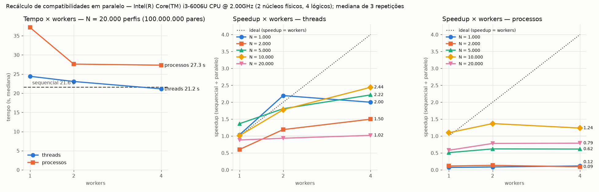

# Algoritmo de Compatibilidade — PlaceMatch

Documento gerado a partir do código-fonte em `backend/matches/algoritmo/`.
Toda alteração de peso ou regra deve ser feita em `config.py` — os demais módulos apenas lêem as constantes definidas ali.

---

## Sumário

1. [Visão geral](#1-visão-geral)
2. [Direção do match e convenção de IDs](#2-direção-do-match-e-convenção-de-ids)
3. [Os 7 critérios e seus pesos](#3-os-7-critérios-e-seus-pesos)
4. [Fórmula de cada critério](#4-fórmula-de-cada-critério)
5. [Tabelas de similaridade categórica](#5-tabelas-de-similaridade-categórica)
6. [Score final](#6-score-final)
7. [Pré-cálculo e armazenamento](#7-pré-cálculo-e-armazenamento)
8. [Implementação vetorial (NumPy)](#8-implementação-vetorial-numpy)
9. [Resultados do benchmark](#9-resultados-do-benchmark)
10. [Limitações conhecidas](#10-limitações-conhecidas)
11. [Afinidade por IA: ThoLuk (7º critério)](#11-afinidade-por-ia-tholuk-7º-critério)
12. [Paralelismo](#12-paralelismo)

---

## 1. Visão geral

O algoritmo calcula um **score de compatibilidade** entre dois perfis, retornando um valor entre **0,0** (incompatível) e **1,0** (compatível perfeito). O score é arredondado em 4 casas decimais e clampado ao intervalo [0, 1].

Existem duas implementações do mesmo cálculo, matematicamente equivalentes:

| Módulo | Função | Uso |
|---|---|---|
| `algoritmo/escalar.py` | `calcular_score(perfil_a, perfil_b)` | Cálculo individual; base de referência |
| `algoritmo/vetorial.py` | `calcular_scores_lote(base, outros, pesos=None)` | Cálculo em lote via NumPy; usado em produção |
| `algoritmo/afinidade.py` | `calibrar`, `combinar`, `vetor_do_perfil` | 7º critério (Afinidade por IA) e soma ponderada com renormalização, usados pelas duas implementações |

`escalar.detalhar_score(a, b)` devolve também o valor de cada critério (usado por `GET /api/compatibilidade/{perfil_id}/`).

---

## 2. Direção do match e convenção de IDs

Somente perfis de **tipos opostos** são comparados:

- `buscando_vaga` ↔ `oferecendo_vaga`
- Perfis do tipo `administrador` são ignorados pelo algoritmo.

O registro `Compatibilidade` no banco sempre segue a convenção:

```
perfil_a_id < perfil_b_id
```

Isso garante unicidade sem duplicatas simétricas. A restrição `unique_together = ('perfil_a', 'perfil_b')` no model `Compatibilidade` reforça essa invariante no banco.

---

## 3. Os 7 critérios e seus pesos

Definidos em `algoritmo/config.py` (devem somar 1,0). Até a versão 1.0.0-rc2 eram 6 critérios (25/25/15/15/10/10); o 7º, a Afinidade por IA, entrou com 10% e os outros foram reduzidos:

| Critério | Peso | Sem a afinidade por IA (renormalizado) | Campo(s) do perfil |
|---|---|---|---|
| `orcamento` | **0,23** | 0,2556 | `orcamento_min`, `orcamento_max` |
| `habitos` | **0,22** | 0,2444 | `fumante`, `aceita_pets`, `aceita_visitas`, `tolerancia_bagunca`, `nivel_organizacao`, `nivel_social` |
| `regiao` | **0,14** | 0,1556 | `regiao` |
| `rotina` | **0,14** | 0,1556 | `perfil_horario`, `nivel_ruido` |
| `moradia` | **0,09** | 0,1000 | `tipo_imovel`, `qtd_moradores` |
| `idade` | **0,08** | 0,0889 | `idade` |
| `afinidade_ia` | **0,10** | — | `bio` (+ `titulo_anuncio` e `descricao_imovel` de quem oferece vaga), via embedding (seção 11). Nome exibido na API: **"Afinidade de interesses (ThoLuk)"** |

```python
PESOS = {
    'orcamento':    0.23,
    'regiao':       0.14,
    'rotina':       0.14,
    'habitos':      0.22,
    'moradia':      0.09,
    'idade':        0.08,
    'afinidade_ia': 0.10,
}
```

---

## 4. Fórmula de cada critério

### 4.1 Orçamento (`sim_orcamento`)

Mede a sobreposição dos intervalos `[min, max]` de cada perfil.

```
overlap   = max(0, min(max_a, max_b) - max(min_a, min_b))
max_range = max(max_a - min_a, max_b - min_b, 1.0)
sim_orcamento = min(1.0, overlap / max_range)
```

Resultado: 1,0 se os intervalos são idênticos; 0,0 se não se sobrepõem.

---

### 4.2 Região (`sim_regiao`)

Comparação exata (após `strip().lower()`):

```
sim_regiao = 1.0 se perfil_a.regiao == perfil_b.regiao, senão 0.0
```

---

### 4.3 Rotina (`sim_rotina`)

Média de duas sub-dimensões:

```
sim_horario = HORARIO_MATRIX[i][j]        # tabela 3×3, ver seção 5
sim_ruido   = 1.0 - |nivel_ruido_a - nivel_ruido_b| / 4.0
sim_rotina  = (sim_horario + sim_ruido) / 2.0
```

`nivel_ruido` é uma escala 1–5 (divisor = 4,0 = diferença máxima possível).

---

### 4.4 Hábitos de convivência (`sim_habitos`)

Média de 6 sub-dimensões:

```
sim_fumante = 1.0 se fumante_a == fumante_b, senão 0.0
sim_pets    = 1.0 se aceita_pets_a == aceita_pets_b, senão 0.0
sim_visitas = VISITAS_MATRIX[i][j]        # tabela 3×3, ver seção 5
sim_bagunca = 1.0 - |tolerancia_bagunca_a - tolerancia_bagunca_b| / 4.0
sim_org     = 1.0 - |nivel_organizacao_a  - nivel_organizacao_b|  / 4.0
sim_social  = 1.0 - |nivel_social_a       - nivel_social_b|       / 4.0

sim_habitos = (sim_fumante + sim_pets + sim_visitas +
               sim_bagunca + sim_org + sim_social) / 6.0
```

Campos de escala 1–5: divisor = 4,0.

---

### 4.5 Estilo de moradia (`sim_moradia`)

Média de duas sub-dimensões:

```
sim_tipo = IMOVEL_MATRIX[i][j]            # tabela 4×4, ver seção 5
sim_qtd  = 1.0 - |qtd_moradores_a - qtd_moradores_b| / 3.0

sim_moradia = (sim_tipo + sim_qtd) / 2.0
```

`qtd_moradores` varia de 1–4 (divisor = 3,0 = diferença máxima possível).

---

### 4.6 Faixa etária (`sim_idade`)

```
diff_idade = |idade_a - idade_b|
sim_idade  = max(0.0, 1.0 - diff_idade / 20.0)
```

Diferença >= 20 anos resulta em sim_idade = 0,0.

---

## 5. Tabelas de similaridade categórica

Definidas em `algoritmo/config.py`. Todas as tabelas são simétricas.

### 5.1 Horário (`HORARIO_MATRIX`)

Índices: `madrugador=0`, `noturno=1`, `flexivel=2`

|  | madrugador | noturno | flexivel |
|---|---|---|---|
| **madrugador** | 1,0 | 0,0 | 0,6 |
| **noturno** | 0,0 | 1,0 | 0,6 |
| **flexivel** | 0,6 | 0,6 | 1,0 |

### 5.2 Visitas (`VISITAS_MATRIX`)

Índices: `raramente=0`, `as_vezes=1`, `frequentemente=2`

|  | raramente | as_vezes | frequentemente |
|---|---|---|---|
| **raramente** | 1,0 | 0,5 | 0,0 |
| **as_vezes** | 0,5 | 1,0 | 0,5 |
| **frequentemente** | 0,0 | 0,5 | 1,0 |

### 5.3 Tipo de imóvel (`IMOVEL_MATRIX`)

Índices: `apartamento=0`, `casa=1`, `republica=2`, `indiferente=3`

|  | apartamento | casa | republica | indiferente |
|---|---|---|---|---|
| **apartamento** | 1,0 | 0,0 | 0,0 | 0,7 |
| **casa** | 0,0 | 1,0 | 0,0 | 0,7 |
| **republica** | 0,0 | 0,0 | 1,0 | 0,7 |
| **indiferente** | 0,7 | 0,7 | 0,7 | 1,0 |

---

## 6. Score final

```
soma  = Σ PESOS[c] * sim_c          # c = os 6 critérios estruturados + afinidade_ia (se houver)
total = Σ PESOS[c]                  # 1,0 com a afinidade; 0,90 sem ela (renormalização)
score_final = round(max(0.0, min(1.0, soma / total)), 4)
```

A soma é feita em Python `float` (não em NumPy), sempre na mesma ordem, pela mesma função (`afinidade.combinar`) nas duas implementações, para garantir resultado idêntico entre escalar e vetorial. A afinidade por IA fica de fora quando um dos perfis não tem embedding (bio com menos de 20 letras) ou com `IA_HABILITADA=False` (seção 11.3).

---

## 7. Pré-cálculo e armazenamento

### Model `Compatibilidade`

```python
class Compatibilidade(models.Model):
    perfil_a    = ForeignKey(Perfil, ...)   # sempre perfil_a.id < perfil_b.id
    perfil_b    = ForeignKey(Perfil, ...)
    score       = FloatField()
    atualizado_em = DateTimeField(auto_now=True)

    class Meta:
        unique_together = ('perfil_a', 'perfil_b')
```

### Quando é recalculado

O signal `post_save` em `Perfil` dispara automaticamente a cada criação ou atualização de perfil:

```python
# matches/signals.py
@receiver(post_save, sender=Perfil)
def recalcular_compatibilidade(sender, instance, **kwargs):
    atualizar_embedding_perfil(instance)   # Afinidade por IA: só se o texto mudou; nunca levanta exceção
    recalcular_lote(instance)
```

### Como é recalculado (`recalcular_lote`)

1. Identifica o tipo oposto (`buscando_vaga` ↔ `oferecendo_vaga`).
2. Busca todos os perfis do tipo oposto em **1 query** (`select_related('usuario', 'embedding_ia')`: os embeddings vêm junto).
3. Calcula os scores em lote via `calcular_scores_lote` (NumPy).
4. Persiste todos os resultados em **1 upsert** (`bulk_create` com `update_conflicts=True`, `batch_size=1000`).

Total: **2 queries ao banco**, independentemente do número de perfis.

---

## 8. Implementação vetorial (NumPy)

### Estratégia

As matrizes de similaridade categórica são convertidas para `np.ndarray` **uma única vez** no import de `vetorial.py`:

```python
_NP_HORARIO = np.array(HORARIO_MATRIX, dtype=np.float64)
_NP_VISITAS = np.array(VISITAS_MATRIX, dtype=np.float64)
_NP_IMOVEL  = np.array(IMOVEL_MATRIX,  dtype=np.float64)
```

Para cada dimensão, os atributos de todos os perfis em `outros` são extraídos em arrays e as operações são feitas de forma vetorizada (uma operação do NumPy sobre o array inteiro, num único núcleo; o paralelismo em vários núcleos está na seção 12):

```python
# Exemplo: horário
hi_a = HORARIO_IDX.get(base.perfil_horario, 2)
hi_b = np.array([HORARIO_IDX.get(p.perfil_horario, 2) for p in outros_list])
sim_hor = _NP_HORARIO[hi_a, hi_b]   # indexação vetorial: retorna array de N floats
```

### Garantia de equivalência

A soma ponderada final é calculada em Python `float` (não em operação NumPy pura) para que o arredondamento em 4 casas seja bit-a-bit idêntico ao da versão escalar:

```python
scores = np.array([
    round(max(0.0, min(1.0,
        pesos['orcamento'] * float(sim_orc[i]) + ...
    )), 4)
    for i in range(n)
], dtype=np.float64)
```

### Teste de equivalência

`EquivalenciaVetorialEscalarReforcoTest` em `matches/tests.py` cobre ~318 perfis sintéticos em memória (SimpleNamespace), incluindo:
- todas as 36 combinações categóricas (`perfil_horario × aceita_visitas × tipo_imovel`);
- extremos e intermediários de todos os campos numéricos;
- seis casos de sobreposição de orçamento;
- oito variações de caixa/espaço na região.

Desde a Afinidade por IA, os perfis do teste também têm vetores de 384 dimensões (1 em cada 4 sem vetor) e o teste exige igualdade **exata**: 50.562 pares comparados, 28.560 com a afinidade, diferença máxima 0,0. O benchmark confirmou `MaxDiff = 0.0` em todos os tamanhos de lote testados.

### Complexidade

| Etapa | Complexidade |
|---|---|
| Cálculo matemático (vetorial) | O(N) no tamanho de `outros` |
| Queries ao banco | O(1) — sempre 2, independente de N |

---

## 9. Resultados do benchmark

Medido em `2026-11-20` com `python manage.py benchmark_compatibilidade --banco-descartavel --repeticoes 3`, **já com o 7º critério** (perfis sintéticos com vetores de 384 dimensões; 1 em cada 5 sem vetor), em PostgreSQL 16 descartável (Docker, banco vazio). CSVs e a saída do terminal em `docs/benchmark/`.

**Ambiente:** Python 3.14.7 · NumPy 2.5.4 · Django 6.1.1 · Windows 10 · Intel Core i3-6006U (2 núcleos físicos, 4 lógicos), com outros programas abertos (veja a observação da seção 12.4: os tempos variam entre execuções).

### Seção A — Cálculo em memória (sem banco), rep=3

| N | Loop mediana (s) | NumPy mediana (s) | Speedup | MaxDiff |
|---|---|---|---|---|
| 100 | 0,003592 | 0,002548 | 1,41x | 0,00e+00 |
| 1.000 | 0,038859 | 0,023621 | 1,65x | 0,00e+00 |
| 10.000 | 0,458948 | 0,240550 | 1,91x | 0,00e+00 |
| 50.000 | 1,178413 | 0,743974 | 1,58x | 0,00e+00 |
| 100.000 | 1,923110 | 1,102609 | 1,74x | 0,00e+00 |

O lote continua com resultado idêntico ao loop (MaxDiff 0) e mais rápido em todos os tamanhos.

### Seção B — Ponta a ponta com banco, rep=3

| N | Loop mediana (s) | NumPy mediana (s) | Speedup | Consultas Loop | Consultas NumPy |
|---|---|---|---|---|---|
| 100 | 1,2579 | 0,0437 | **29x** | 201 | 2 |
| 1.000 | 10,8877 | 0,3158 | **34x** | 2.001 | 2 |
| 5.000 | 62,8416 | 2,4153 | **26x** | 10.001 | 6 (1 consulta + upsert em 5 lotes de 1.000) |

N = 5.000 com 2 repetições (o aquecimento do loop passou de 30 s). As consultas são contadas com `connection.execute_wrapper` (exato, sem o limite de 9.000 do log do Django e sem BEGIN/COMMIT/SAVEPOINT).

**Correção do benchmark (Parte 2 da Afinidade por IA):** antes, a seção B rodava todas as repetições dentro de UMA transação desfeita no final. Cada repetição apagava e regravava milhares de linhas de `matches_compatibilidade`, e dentro da transação o PostgreSQL não podia limpar as versões mortas: as repetições seguintes ficavam cada vez mais lentas, e N = 5.000 aparecia com **45,95 s** no lote. Agora cada repetição roda na **sua própria transação** (e a limpeza em outra), e a seção B só roda com `--banco-descartavel` num banco **vazio** (os dados sintéticos são gravados de verdade e apagados no final). Resultado: **2,42 s** para os mesmos 5.000 perfis.

O ganho real em produção continua vindo do **padrão de acesso ao banco**: a versão loop faz N+1 consultas (2 por perfil: busca e grava), a versão em lote faz sempre 2 (mais 1 por lote de 1.000 linhas no upsert).

### Seção C — Sensibilidade dos pesos (20 bases × 1.000 outros, top-10 em comum com ±5 pp)

| Critério | Peso | +5 pp | −5 pp |
|---|---|---|---|
| orcamento | 0,23 | 0,875 | 0,880 |
| regiao | 0,14 | 0,980 | 0,825 |
| rotina | 0,14 | 0,880 | 0,870 |
| habitos | 0,22 | 0,905 | 0,895 |
| moradia | 0,09 | 0,835 | 0,850 |
| idade | 0,08 | 0,830 | 0,785 |
| afinidade_ia | 0,10 | 0,895 | 0,885 |

Mudar a afinidade por IA em 5 pontos troca em média 1 dos 10 primeiros da lista: o critério influencia a ordem sem dominar o score.

---

## 10. Limitações conhecidas

- **Score não é recalculado em cascata:** ao atualizar o perfil A, recalcula-se A ↔ todos os opostos, mas não os pares que não envolvem A.
- **Região é binária:** qualquer diferença de grafia (maiúsculas, acentos, espaços extras) resulta em `sim_regiao = 0,0`. Normalização básica (`strip().lower()`) já é aplicada, mas variações como "sp" vs "São Paulo" não são tratadas.
- **Campos categóricos sem valor reconhecido** usam o default definido em `config.py` (`flexivel`, `as_vezes`, `indiferente`) — o valor inválido não gera erro, mas pode distorcer silenciosamente o score.
- **Benchmark rodado em máquina de desenvolvimento (Windows 10, 2 núcleos físicos, com outros programas abertos):** os números absolutos não refletem o ambiente de produção e variam entre execuções; os speedups relativos entre loop e lote são comparáveis. O paralelismo (seção 12) é o mais afetado.
- **N=5.000 no benchmark com banco** teve as repetições reduzidas de 3 para 2 (aquecimento do loop > 30 s).
- **Gravar no banco domina o recálculo completo** (99,8% do tempo com 250.000 pares, seção 12.4 C): mais núcleos não aceleram o comando; a próxima otimização seria a gravação (`COPY`).
- **O ThoLuk mede assunto, não posição** ("durmo de madrugada" × "acordo às cinco" dá cosseno 0,78): por isso tem só 10% e a posição fica com os critérios estruturados (seção 11.4).
- **Temas de frases muito curtas** são pouco confiáveis; a margem foi calibrada com bios completas (seção 11.5).
- **Modelo ocupa ~560 MB de RAM** por processo do servidor (cada worker do gunicorn carrega o seu). Com `IA_HABILITADA=False` nada é carregado.

---

## 11. Afinidade por IA: ThoLuk (7º critério)

**ThoLuk, a IA de afinidade do PlaceMatch.** Na interface, na API e nesta documentação o 7º critério aparece pelo nome (no masculino: "o ThoLuk"): "Afinidade de interesses (ThoLuk)", selo "ThoLuk", aba "ThoLuk (IA)" do painel, `nome_ia: "ThoLuk"` nas respostas. O código mantém o nome técnico `ia` (app, rotas `/api/admin/ia/...`, campos `afinidade_ia`/`temas_em_comum`/`analise_ia`, variáveis `IA_*`, ação de log `IA_TESTE`).

Evolução prevista no documento de abertura: "similaridade vetorial usando embeddings de texto da biografia". Um modelo de linguagem **local** transforma o texto de cada perfil num vetor (embedding) e o cosseno entre dois vetores mede o quanto as bios **falam das mesmas coisas**, mesmo com palavras diferentes ("adoro cozinhar para os amigos" × "faço jantares em casa no fim de semana").

### 11.1 Modelo

| | |
|---|---|
| Modelo | `sentence-transformers/paraphrase-multilingual-MiniLM-L12-v2` (multilíngue, treinado para paráfrases; cópia ONNX publicada pela Qdrant) |
| Dimensões | 384 |
| Execução | `fastembed` 0.9.1 + ONNX Runtime 1.32.0, só CPU, **sem PyTorch** |
| Tamanho em disco | 241 MB em `IA_MODELO_DIR` (padrão `backend/.modelos/`, fora do git; o `.onnx` tem 235 MB) |
| Configuração | `IA_HABILITADA` (padrão `True`), `IA_MODELO_DIR`; `IA_EMBEDDER=falso` só nos testes |
| Código | `ia/servico.py` (carga e embeddings), `ia/embeddings.py` (persistência), `ia/temas.py`, `matches/algoritmo/afinidade.py` (cosseno, calibração e combinação) |

O fastembed 0.9.1 suporta exatamente o modelo pedido (`TextEmbedding.list_supported_models()`), então não foi preciso trocar. Alternativas avaliadas na mesma lista: `paraphrase-multilingual-mpnet-base-v2` (768 dimensões, 1 GB) e `multilingual-e5-large` (1024, 2,2 GB) — mais pesadas sem necessidade para bios de 500 caracteres.

**Carga:** uma única vez por processo, sob demanda (primeiro uso), protegida por trava (`threading.RLock`): 8 threads pedindo o modelo ao mesmo tempo geram uma só carga (teste `test_carrega_uma_unica_vez_mesmo_com_varias_threads`). Com os arquivos já baixados, o modelo é aberto com `local_files_only=True` (nenhum acesso à rede). Se a carga falhar (sem internet na primeira vez, arquivo corrompido, falta de memória), o erro vai para o logger `ia.servico`, o serviço fica `indisponivel` e uma nova tentativa só acontece depois de 5 minutos (ou com `baixar_modelo_ia`). **Nenhuma rota devolve 500 por causa da IA.**

**Aquecimento:** quando o servidor da API sobe (`runserver`, no processo que atende, ou `gunicorn`) com `IA_HABILITADA` e `IA_AQUECIMENTO` ligados, `IaConfig.ready()` inicia uma thread daemon que carrega o modelo e as frases dos temas em segundo plano: a subida não espera e o primeiro perfil salvo já encontra o modelo pronto. Nunca roda em testes, `migrate` ou outros comandos (`ia/aquecimento.py`). Durante a carga, `GET /api/admin/ia/status/` responde na hora com `situacao` = `carregando` (`situacao_texto` "Carregando"), e depois `disponivel` ou `indisponivel`: a carga usa uma trava própria e o status nunca espera por ela. No `gunicorn --preload`, cada worker zera o estado herdado do fork e aquece o seu próprio modelo.

### 11.2 Embeddings dos perfis (`ia_embeddingperfil`)

- **Texto de origem:** "Sobre você" (`bio`) + título e descrição do anúncio para quem oferece vaga.
- **Mínimo:** 20 caracteres úteis (letras e dígitos). Abaixo disso não há embedding (e um embedding antigo é apagado).
- **Quando:** no mesmo signal `post_save` do perfil, **antes** do recálculo da compatibilidade. Só gera de novo se o SHA-256 do texto (ou o modelo) mudou: salvar o perfil mudando idade ou orçamento não chama o modelo.
- **Armazenamento compacto:** 384 × float32 normalizados (norma 1) = 1536 bytes em `bytea` (restrição `embedding_vetor_384_ck`). Como o vetor é normalizado, o cosseno é só o produto escalar.
- **Modelo fora do ar ao editar:** o perfil é salvo normalmente; se o texto mudou, o vetor antigo é apagado (não representa mais a bio) e o par fica sem o 7º critério até `gerar_embeddings`.
- **Comando:** `python manage.py gerar_embeddings [--forcar] [--lote 32] [--sem-recalcular]` processa todos os perfis com progresso e tempo e roda `recalcular_compatibilidades` no final.

### 11.3 Cosseno, calibração e renormalização

```
cos        = round(v_a · v_b, 4)                       # vetores normalizados
afinidade  = clamp((cos - 0,20) / (0,65 - 0,20), 0, 1) # IA_COSSENO_PISO, IA_COSSENO_TETO
```

**Pesos** (somam 100%): orçamento 23% · hábitos 22% · região 14% · rotina 14% · moradia 9% · idade 8% · **afinidade IA 10%**.

**Renormalização:** se um dos dois perfis não tem embedding (bio curta) ou o ThoLuk está desligado, a afinidade fica de fora e o score é a soma dos outros 6 divididos pela soma dos pesos deles (0,90):

```
score = Σ peso_i · sim_i / Σ peso_i      (i = critérios presentes)
```

Assim, dois perfis idênticos nos 6 critérios têm score 1,0 com ou sem bio — **ninguém é penalizado por ter bio curta**. O peso efetivo de cada critério aparece em `GET /api/compatibilidade/{perfil_id}/` (ex.: orçamento 0,2556 quando a IA não entra).

**Equivalência escalar × vetorial:** as duas implementações chamam as mesmas funções `calibrar` e `combinar` (`afinidade.py`); o lote calcula todos os cossenos num único produto matriz × vetor (m × 384 · 384). O cosseno é arredondado em 4 casas antes da calibração, então uma diferença de último bit entre `np.dot` e o produto matricial não muda o resultado. O teste `EquivalenciaVetorialEscalarReforcoTest` agora tem vetores (1 em cada 4 perfis sem embedding) e exige igualdade **exata**: 50.562 pares, 28.560 com afinidade por IA, diferença máxima 0,0. `EquivalenciaComIATest` repete com 3.200 pares aleatórios.

### 11.4 Calibração (tabela)

Medida com o modelo real (`python` + `ia.servico.gerar_vetores`) em 24 pares de frases e nas 104 combinações buscando × oferecendo do `seed_demo`. Valores finais em `matches/algoritmo/config.py`.

| # | Grupo | Texto A | Texto B | Cosseno | Afinidade | Temas A / B |
|---|---|---|---|---|---|---|
| 1 | parecidas | Adoro cozinhar para os amigos. | Faço jantares em casa no fim de semana. | 0.467 | 0.59 | Culinária / Culinária, Trabalho remoto |
| 2 | parecidas | Passo o dia estudando para concursos. | Minha rotina é de muita leitura e preparação para provas. | 0.669 | 1.00 | Estudos / Estudos |
| 3 | parecidas | Trabalho de casa, em home office, o dia inteiro. | Sou programador remoto e fico no computador em casa. | 0.569 | 0.82 | Trabalho remoto, Organização e limpeza / Trabalho remoto, Organização e limpeza, Games |
| 4 | parecidas | Corro todas as manhãs e vou à academia. | Treino musculação cedo e gosto de correr no parque. | 0.480 | 0.62 | Esportes e academia / Esportes e academia, Natureza e trilhas |
| 5 | parecidas | Tenho um gato e amo animais. | Sou apaixonada por bichos, tenho uma cachorrinha. | 0.760 | 1.00 | Pets / Pets |
| 6 | parecidas | Gosto de casa silenciosa, durmo cedo. | Prefiro ambientes tranquilos e sem barulho à noite. | 0.702 | 1.00 | Silêncio e tranquilidade, Leitura / Silêncio e tranquilidade |
| 7 | parecidas | Toco violão e escuto música o tempo todo. | Sou músico, ensaio guitarra e vou a shows. | 0.723 | 1.00 | Música, Festas e vida social / Música, Festas e vida social |
| 8 | parecidas | Nos fins de semana faço trilhas e acampo. | Adoro natureza, cachoeiras e caminhadas no mato. | 0.606 | 0.90 | Natureza e trilhas / Natureza e trilhas, Organização e limpeza |
| 9 | neutras | Adoro cozinhar para os amigos. | Estudo engenharia civil na faculdade. | 0.070 | 0.00 | Culinária / Estudos, Arte |
| 10 | neutras | Tenho um gato e amo animais. | Trabalho como enfermeira em plantões. | 0.240 | 0.09 | Pets / Sustentabilidade, Organização e limpeza |
| 11 | neutras | Toco violão nas horas vagas. | Sou organizada e mantenho tudo limpo. | 0.276 | 0.17 | Música, Games, Festas e vida social / Organização e limpeza, Sustentabilidade |
| 12 | neutras | Faço trilhas nos fins de semana. | Jogo videogame à noite com amigos online. | 0.235 | 0.08 | Natureza e trilhas / Games, Festas e vida social |
| 13 | neutras | Sou estudante de direito. | Gosto de séries de comédia. | 0.163 | 0.00 | Estudos, Música / Festas e vida social, Cinema e séries, Música |
| 14 | neutras | Trabalho de casa com design gráfico. | Vou à igreja aos domingos. | 0.036 | 0.00 | Arte, Trabalho remoto, Organização e limpeza, Estudos / Religião e espiritualidade |
| 15 | neutras | Leio muitos livros de ficção. | Corro todas as manhãs. | 0.038 | 0.00 | Leitura, Estudos / Esportes e academia |
| 16 | neutras | Cuido de plantas na varanda. | Sou de Recife e estudo medicina. | 0.086 | 0.00 | — / Estudos |
| 17 | opostas | Adoro festas e receber gente em casa toda semana. | Preciso de silêncio absoluto, odeio barulho e visitas. | 0.117 | 0.00 | Culinária, Festas e vida social, Cinema e séries / Silêncio e tranquilidade |
| 18 | opostas | Vivo em festas e baladas. | Sou caseira, fico em casa lendo em silêncio. | 0.345 | 0.32 | Festas e vida social, Música / Silêncio e tranquilidade, Leitura, Trabalho remoto, Organização e limpeza |
| 19 | opostas | Sou muito bagunceiro e não ligo para limpeza. | Sou extremamente organizada, tudo tem que estar limpo. | 0.603 | 0.90 | Sustentabilidade, Organização e limpeza / Organização e limpeza, Sustentabilidade |
| 20 | opostas | Fumo e bebo bastante nas baladas. | Não suporto cigarro nem bebida, levo vida saudável. | 0.512 | 0.69 | Festas e vida social / — |
| 21 | opostas | Tenho três cachorros grandes. | Tenho alergia a animais e não quero pets. | 0.471 | 0.60 | Pets / Pets, Sustentabilidade |
| 22 | opostas | Durmo de madrugada e acordo ao meio-dia. | Acordo às cinco da manhã e durmo às nove da noite. | 0.776 | 1.00 | Silêncio e tranquilidade, Esportes e academia / Silêncio e tranquilidade, Esportes e academia |
| 23 | idênticas | Adoro cozinhar para os amigos. | Adoro cozinhar para os amigos. | 1.000 | 1.00 | Culinária / Culinária |
| 24 | idênticas | Sou estudante tranquila e organizada. | Sou uma estudante tranquila e bem organizada. | 0.986 | 1.00 | Estudos, Silêncio e tranquilidade / Estudos, Silêncio e tranquilidade |

Os temas de frases soltas (uma linha) são menos confiáveis que os de bios completas: a margem compara o tema com a média do próprio texto, e um texto de 5 palavras tem pouca informação (ex.: "Organização e limpeza" no par 3). Na tela, os temas aparecem só para bios, e só os temas EM COMUM.

**Como o piso e o teto foram escolhidos:**

- Frases sem relação ficam entre 0,04 e 0,28; frases com o mesmo interesse em palavras diferentes, entre 0,47 e 0,76.
- Bios completas (2 a 4 frases, várias ideias) têm cossenos mais altos entre si: nas 104 combinações do seed, mínimo 0,128, mediana 0,396 e máximo 0,679. Com piso 0,20 e teto 0,65, a bio "sem relação" típica (0,30 a 0,45) cai **perto do meio** (afinidade 0,22 a 0,55, mediana 0,44). Isso evita que ter bio seja pior do que não ter: sem bio o critério sai e os outros 6 são renormalizados; com bio neutra, a afinidade fica próxima da média dos outros critérios.
- O teto 0,65 dá afinidade 1,0 a pares claramente parecidos (Isabela × Henrique: 0,679).

**Limitação medida (importante):** o modelo mede **assunto**, não **posição**. Frases opostas sobre o mesmo assunto ficam com cosseno alto: "durmo de madrugada" × "acordo às cinco" (par 22) e "bagunceiro" × "organizada" (par 19). Por isso a afinidade tem só 10% e a posição continua com os critérios estruturados (rotina, hábitos, visitas, fumante, pets), que já separam esses casos. Opostos de assunto diferente (festas × silêncio, pares 17 e 18) ficam baixos, como esperado.

### 11.5 Temas em comum (explicação visível)

`ia/temas.py` tem 16 temas de convivência (culinária, estudos, trabalho remoto, música, festas e vida social, silêncio e tranquilidade, esportes e academia, games, leitura, pets, natureza e trilhas, arte, religião e espiritualidade, cinema e séries, sustentabilidade, organização e limpeza), cada um com 2 a 3 frases (44 no total). Classificação **zero-shot** (nada é treinado):

1. As 44 frases dos temas viram embeddings uma vez por processo (memória).
2. Nota do tema = maior cosseno entre o texto e as frases do tema.
3. O texto tem o tema quando **nota ≥ 0,45** (`LIMIAR_TEMA`) **e nota ≥ média das 16 notas do texto + 0,135** (`MARGEM_TEMA`), no máximo 5 temas (`MAX_TEMAS`).
4. Os ids ficam em `ia_embeddingperfil.temas`; temas em comum = interseção dos dois perfis.

A margem relativa foi necessária: bios longas "parecem" um pouco com tudo (média 0,30 a 0,46), e só o limiar absoluto marcava "festas" em bios que só citam amigos. Mudou a lista de temas? Rode `gerar_embeddings --forcar`.

**Revisão das frases (pré-freeze).** O laboratório do painel mostrou falsos positivos: "Faço jantares em casa no fim de semana e curto gastronomia." recebia **Trabalho remoto** e **Organização**, e "Amo festas, receber gente em casa e sair toda sexta." recebia **Organização** e **Culinária**. A causa é que o modelo também compara a **forma** da frase: as frases-modelo repetiam expressões que aparecem em bios de qualquer tema ("**em casa**", "passo as noites", "Faço…", "para os amigos"). As frases foram reescritas centradas no assunto (ex.: Trabalho remoto = home office, reuniões online, trabalho remoto pela internet; Organização = tudo arrumado, limpo, cada coisa no lugar, faxina), sem "computador" (que puxava bios de estudantes de Computação), e a margem passou de 0,13 para 0,135.

| Texto | Antes | Depois |
|---|---|---|
| Lab. 1A "Adoro cozinhar para os amigos e testar receitas novas." | Culinária | Culinária |
| Lab. 1B "Faço jantares em casa no fim de semana e curto gastronomia." | Culinária, **Trabalho remoto**, **Organização** | Culinária |
| Lab. 2A "Amo festas, receber gente em casa e sair toda sexta." | Festas, **Culinária**, **Organização** | Festas |
| Lab. 2B "Gosto de silêncio, leio muito e durmo cedo." | Leitura, Silêncio | Leitura, Silêncio |
| Lab. 3A "Estou no último ano de engenharia e passo as noites estudando." | Estudos, **Games** | Estudos |
| Lab. 3B "Faço mestrado e preciso de um ambiente tranquilo para estudar." | Estudos, Silêncio | Estudos, Silêncio |
| Seed: Elizabete (artista plástica) | Arte, **Sustentabilidade** | Arte |
| Seed: Henrique (gastronomia) | Culinária, **Sustentabilidade** | Culinária |
| Seed: Patrícia (analista; silêncio e organização) | Organização, Silêncio, **Trabalho remoto** | Silêncio, Organização |
| Seed: Pedro (desenvolvedor, guitarra, videogame) | Games, Música | Música (Games ficou a 0,13 acima da média, logo abaixo da margem) |
| Seed: Thiago (músico, casa cheia de amigos) | Festas, Música | Música |

Exemplos 1, 2 e 3 do laboratório: temas em comum Culinária, nenhum e Estudos. Os temas esperados estão fixados em `ia/tests/test_temas_modelo_real.py` (modelo real; pulado sem o modelo): os 3 exemplos do laboratório, 16 bios do seed, as bios dos exemplos do Swagger e os falsos positivos corrigidos. **Limitação que continua:** frases com "em casa" ainda podem puxar Organização ("Faço jantares em casa no fim de semana e sempre sobra comida." recebe Culinária e Organização, no exemplo do Swagger); cada frase nova mexe na média de todos os textos, então novos ajustes devem passar pelo teste com o modelo real.

### 11.6 Pares do `seed_demo` (banco descartável, modelo real)

| Par (buscando × oferecendo) | Relação | Cosseno | Afinidade IA | Temas em comum | Score total |
|---|---|---|---|---|---|
| Isabela Nunes × Henrique Moura | mesmo interesse, palavras diferentes ("adoro cozinhar para os amigos" × "faço jantares em casa no fim de semana") | 0,679 | **1,00** | Culinária | 60% |
| Pedro Henrique × Thiago Santos | "toco guitarra e escuto rock" × "sou músico, toco em bares, ensaio com a banda" | 0,614 | **0,92** | Música | 67% |
| Ana Luísa × Beatriz Almeida | "tenho uma gata" × "divido o apê com dois cachorros resgatados" | 0,575 | **0,83** | Pets | 81% |
| Rafael Costa × Clara Freitas | "valorizo uma casa quieta" × "valorizo muito o silêncio" | 0,527 | **0,73** | Silêncio e tranquilidade | 71% |
| Mariana Oliveira × João Vitor | "livros, plantões e provas" × "corrijo provas e preparo aulas" | 0,491 | **0,65** | Estudos | 56% |
| Lucas Mendes × Júlia Prado | "cachoeiras e trilhas" × "trilha, acampamento e mar" | 0,486 | **0,63** | Natureza e trilhas | 54% |
| Guilherme Alves × Marcos Vinícius | festas × festas (bios com outros assuntos misturados) | 0,357 | 0,35 | Festas e vida social | 54% |
| Patrícia Gomes × Thiago Santos | OPOSTOS: silêncio × casa cheia de amigos | 0,326 | 0,28 | — | 12% |
| Rafael Costa × Marcos Vinícius | OPOSTOS: casa quieta × música alta até de madrugada | 0,151 | **0,00** | — | 32% |
| Mariana Oliveira × Marcos Vinícius | OPOSTOS: rotina de estudos × festa na piscina | 0,128 | **0,00** | — | 35% |

Nas 104 combinações buscando × oferecendo: cosseno mínimo 0,128, mediana 0,396, máximo 0,679; afinidade mínima 0,00, mediana 0,44, máxima 1,00.

Temas que o ThoLuk detecta em cada perfil (frases revisadas, margem 0,135):

| Perfil | Temas | Perfil | Temas |
|---|---|---|---|
| Ana Luísa | Arte, Pets | Beatriz Almeida | Pets |
| Camila Souza | Pets | Clara Freitas | Silêncio e tranquilidade |
| Diego Ferreira | Cinema e séries | Henrique Moura | Culinária |
| Elizabete Ramos | Arte | João Vitor | Estudos, Silêncio e tranquilidade, Leitura |
| Fernanda Lima | Silêncio e tranquilidade, Leitura | Júlia Prado | Pets, Natureza e trilhas |
| Guilherme Alves | Festas e vida social | Marcos Vinícius | Festas e vida social |
| Isabela Nunes | Culinária | Renato Barbosa | Trabalho remoto |
| Lucas Mendes | Trabalho remoto, Natureza e trilhas, Arte | Thiago Santos | Música |
| Mariana Oliveira | Estudos | | |
| Patrícia Gomes | Silêncio e tranquilidade, Organização e limpeza | | |
| Pedro Henrique | Música | | |
| Rafael Costa | Silêncio e tranquilidade | | |
| Vitória Cardoso | Esportes e academia, Natureza e trilhas | | |

O score total continua dominado pelos critérios estruturados: Isabela × Henrique têm afinidade 1,0 mas score 60% (horário, visitas e moradia diferentes); Ana × Beatriz têm 81%.

### 11.7 API

| Rota | Quem | O que traz |
|---|---|---|
| `GET /api/descoberta/` | usuário comum | `afinidade_ia` (0 a 1 ou `null`) e `temas_em_comum` em cada item; embeddings via `select_related` (o número de consultas não cresce com o número de cards — teste `test_sem_consultas_n_mais_1`) |
| `GET /api/perfis/{id}/` | logado | os mesmos dois campos em relação ao usuário (`null`/`[]` no próprio perfil e para o admin) |
| `GET /api/perfis/` (e a resposta de criar/editar) | dono do perfil | `analise_ia`: `situacao` (`analisada`, `bio_curta`, `pendente` ou `ia_desligada`), os temas da própria bio e a contagem de letras e dígitos (mínimo 20); `null` nos perfis de outras pessoas. É o bloco "Temas que a IA identificou na sua bio" do Meu Perfil |
| `GET /api/compatibilidade/{perfil_id}/` | usuário comum, perfil do tipo oposto ativo | score, os 7 critérios (peso, peso efetivo, valor, contribuição), afinidade, cosseno, temas de cada um e em comum, `ia_disponivel`, `motivo_sem_ia` |
| `GET /api/admin/ia/status/` | administrador | modelo, dimensões, disponível, perfis com embedding × total, temas (com contagem), tempo médio de geração, última atualização, calibração |
| `POST /api/admin/ia/testar/` | administrador | `{texto_a, texto_b}` (até 1000 caracteres) → cosseno, afinidade, temas, tempo; 503 sem o modelo; log `IA_TESTE` **sem os textos** |

Nada nas três primeiras rotas chama o modelo: os vetores já estão gravados, então elas funcionam mesmo com o modelo fora do ar.

### 11.8 Desempenho medido

Medido em 20/11/2026 na máquina de desenvolvimento (Windows 10, Intel64 Family 6 Model 78, Python 3.12.4, fastembed 0.9.1,
onnxruntime 1.32.0, só CPU). Scripts das medições: carga e embeddings num processo novo; recálculo em banco PostgreSQL 16 descartável.

**Modelo**

| Medida | Resultado |
|---|---|
| Download + primeira carga (`baixar_modelo_ia`, 1ª vez) | ~35 s (download de 241 MB) |
| Import do fastembed/onnxruntime | 2,0 a 3,1 s (uma vez por processo) |
| Carga do modelo + aquecimento (arquivos já baixados) | 3,0 a 3,3 s (uma vez por processo; dentro do `runserver`, com o import, 9,3 s no 1º uso) |
| Embeddings das 43 frases dos temas | ~0,9 s (uma vez por processo) |
| **Memória** | +561 MB ao carregar (69 → 630 MB), pico de 645 MB depois de 105 embeddings |
| **Embedding de uma bio + temas** (fluxo do signal, 105 textos) | média **88 ms**, mediana 79 ms, p95 157 ms |
| Lotes de textos (63 bios) | 72 ms/texto com `batch_size=1`; 103 (4), 114 (8), 121 (16) e 136 ms (32): **lote maior é mais lento** neste CPU, porque todos os textos são preenchidos até o tamanho do mais longo. Por isso o serviço usa `batch_size=1`. |
| `gerar_embeddings --forcar` no seed (21 perfis) | 3,2 s (inclui as frases dos temas) |

**Recálculo em lote com o novo critério** (`recalcular_lote`: 1 perfil × N do tipo oposto, todos com embedding — pior caso; 7 repetições, dados gravados):

| N (perfis do tipo oposto) | Com o 7º critério (mediana / mín.) | Só 6 critérios (`IA_HABILITADA=False`) | Consultas |
|---|---|---|---|
| 100 | 45 ms / 35 ms | 38 ms / 32 ms | 2 |
| 1.000 | 400 ms / 331 ms | 468 ms / 332 ms | 2 |
| 5.000 | 2,38 s / 2,05 s | 1,99 s / 1,78 s | 8 (upsert em lotes de 1.000) |

O custo do 7º critério no recálculo é de 0 a 20%: os vetores vêm na mesma consulta (`select_related('embedding_ia')`) e os cossenos saem de um único produto matricial. Em memória (benchmark, seção A), 100.000 pares levam 2,8 s no lote.

### 11.9 Privacidade

- O modelo roda **no próprio servidor**: as bios não são enviadas para nenhum serviço externo (nem de IA, nem de nuvem).
- A internet só é usada uma vez, para baixar os arquivos do modelo (`baixar_modelo_ia`). Depois disso o servidor abre o modelo com `local_files_only=True` e a telemetria do Hugging Face fica desligada (`HF_HUB_DISABLE_TELEMETRY=1`).
- O banco guarda só o vetor e o SHA-256 do texto (o texto já está no perfil). O teste do painel registra no log apenas o tamanho dos textos e o resultado.
- O vetor não é exposto pela API; só a afinidade (um número) e os temas.

### 11.10 Testes

`ia/tests/` (87 testes) usa o **embedder falso determinístico** (`IA_EMBEDDER=falso`: cada radical de palavra vira um vetor pseudoaleatório fixo), sem baixar nem carregar modelo. Cobre: serviço (carga única com threads, falha de carga, nova tentativa, arquivo corrompido, IA desligada), calibração, pesos e renormalização, sem embedding, equivalência escalar × vetorial, signal (só regera quando o texto muda, bio curta, anúncio, modelo antigo, falhas), rotas (permissões, validações, N+1, 503, log sem textos, **nenhum 500 com o modelo fora do ar**), comandos e temas. Só `test_integracao_modelo.py` usa o modelo real e é **pulado** se ele não estiver baixado.

---

## 12. Paralelismo

A seção 8 é **vetorização**: uma operação do NumPy percorre um array inteiro em código C, mas num único núcleo. Esta seção é **paralelismo**: vários núcleos trabalhando ao mesmo tempo nos processamentos em lote, o recálculo completo das compatibilidades e a geração de embeddings. O uso normal (salvar um perfil, que recalcula 1 × N pelo signal, e a Descoberta) **não mudou**.

### 12.1 Recálculo completo em blocos

`python manage.py recalcular_compatibilidades` (`matches/processamento.py`):

1. **Carregar (sequencial, 2 consultas):** os atributos de todos os perfis buscando e oferecendo e os embeddings válidos são lidos **uma vez** e viram arrays NumPy (`algoritmo/matriz.py`, `Grupo`).
2. **Calcular (paralelo):** a matriz buscando × oferecendo é dividida em **blocos de 256 × 256 pares** (`matriz.blocos`). Cada bloco é independente: as fórmulas da seção 4 são aplicadas por broadcasting (256 × 256 de uma vez) e os cossenos saem de um produto de matrizes (256 × 384 · 384 × 256). Os workers só fazem conta: **não acessam o banco nem carregam o modelo de IA**.
3. **Gravar (sequencial):** o processo principal junta os blocos e grava tudo com `bulk_create` (upsert) em **uma transação**.

Por que 256 × 256: medido nesta máquina, arrays acima de ~1 MB custam ~8× mais por elemento no Windows (cada operação pede memória nova ao sistema e paga as faltas de página), e até 512 KB o alocador reaproveita a memória; o bloco quadrado também deixa os embeddings do bloco (1,5 MB) no cache L3 (3 MB). Com blocos de 64 × 1024 o sequencial ficou ~1,6× mais lento.

**Resultado idêntico com qualquer número de workers.** A divisão em blocos depende só do tamanho dos grupos, nunca do número de workers: os workers só escolhem **quem** calcula cada bloco, e cada bloco é sempre calculado do mesmo jeito. Além disso o núcleo reproduz bit a bit o cálculo do dia a dia (escalar e vetorial): as mesmas operações em float64 na mesma ordem e o `round(x, 4)` do Python reproduzido exatamente (`arredondar4`; o `np.round` erra em valores terminados em 5). O score volta como inteiro (score × 10.000, `uint16`). Os testes comparam a matriz inteira, com igualdade exata, nos modos sequencial, threads e processos com 1, 2 e 3 workers, e o comando contra os scores gravados pelo signal (`matches/test_paralelismo.py`); o benchmark confere de novo em cada repetição.

### 12.2 Processos × threads (e o GIL)

| | Threads (`ThreadPoolExecutor`) | Processos (`ProcessPoolExecutor`) |
|---|---|---|
| Memória | compartilhada: os workers leem os mesmos arrays | cada worker é outro interpretador; os arrays vão para **memória compartilhada** (`multiprocessing.shared_memory`) uma vez, e o initializer de cada worker só recebe os nomes e formatos e monta os arrays sobre ela, sem cópia. Os workers escrevem os scores direto numa matriz de saída também compartilhada. |
| GIL | um só para todas as threads: o NumPy **solta o GIL** durante cada operação em array (o laço em C), então duas threads calculam ao mesmo tempo; o código Python entre as operações (montar o bloco, chamar a próxima operação) volta a disputar o GIL | cada processo tem o seu GIL: nenhuma disputa |
| Custo de começar | quase zero (as threads nascem no mesmo processo) | **subir os workers**: no Windows (`spawn`) cada um é um interpretador novo que importa o NumPy de novo; no Linux/Docker usa-se `forkserver` com este módulo pré-carregado (os workers nascem de um processo limpo e já pronto; nada do Django é herdado) |
| Falhas | erro numa thread → refaz no sequencial | não consegue criar processos, worker morto (`BrokenProcessPool`), sem memória → refaz no sequencial |

Nos dois modos o BLAS (OpenBLAS, usado no produto de matrizes) fica limitado a **1 thread por worker** (`threadpoolctl`). Sem isso, 4 workers × 4 threads do OpenBLAS disputariam 4 núcleos lógicos, e o próprio "sequencial" usaria vários núcleos escondido, o que deixaria a comparação desonesta.

Se o pool falhar, o cálculo é refeito no modo sequencial e o aviso vai para o log (`matches.processamento`) e para a saída do comando; nada é gravado pela metade, porque a gravação só acontece depois do cálculo inteiro.

Opções: `--modo auto|processos|threads|sequencial` (padrão `auto`, veja 12.6) e `--workers N` (1 a 16; padrão `PROCESSAMENTO_WORKERS`, que por padrão é `min(4, núcleos)`).

### 12.3 Lei de Amdahl

Se uma fração **p** do trabalho pode ser dividida entre n workers e o resto (1 − p) não pode, o speedup máximo é

```
S(n) = 1 / ((1 − p) + p / n)            speedup  = tempo sequencial ÷ tempo paralelo
                                        eficiência = speedup ÷ n
```

Mesmo com infinitos workers, S nunca passa de 1 / (1 − p). O benchmark estima p a partir dos speedups medidos com 2 e 4 workers (mínimos quadrados em 1/S = (1 − p) + p/n). Tudo o que não se divide entra em (1 − p): criar os processos, montar os blocos, juntar o resultado e, no comando real, **ler e gravar no banco**.

### 12.4 Resultados medidos (`benchmark_paralelismo`)

Medido em 20/11/2026 com `python manage.py benchmark_paralelismo --banco-descartavel` (23 min). Arquivos: [`benchmark/paralelismo.json`](./benchmark/paralelismo.json), [`paralelismo.csv`](./benchmark/paralelismo.csv) e o gráfico [`paralelismo.png`](./benchmark/paralelismo.png); o JSON é servido em `GET /api/admin/processamento/benchmark/` (administrador).

**Ambiente:** Intel(R) Core(TM) i3-6006U CPU @ 2.00GHz (**2 núcleos físicos, 4 lógicos**), 16.384 MB de RAM (3.870 MB livres), Windows 10 (10.0.19045), Python 3.14.7, NumPy 2.5.4 (openblas 0.3.34.106.0 (4 threads); limitado a 1 thread por worker), threadpoolctl 3.8.0, fastembed 0.9.1, onnxruntime 1.32.0.

> **Atenção: máquina ocupada.** A CPU já estava com **100% de uso no início** do benchmark e com **70% a 86% de uso médio** só com os programas abertos (VS Code, Chrome, Docker Desktop com o banco de desenvolvimento), medido antes e depois. Sobra cerca de 1 núcleo lógico livre: o ganho fica bem abaixo do teórico e os tempos variam muito entre repetições (veja 12.5). Para números limpos, rode o benchmark com a máquina ociosa; os arquivos e o gráfico são regravados.



**A) Recálculo**: dados sintéticos em memória (metade buscando, metade oferecendo, 4 em cada 5 com embedding; N perfis → N²/4 pares), aquecimento e **mediana de 3 repetições**. "Idêntico": a matriz inteira de scores é igual à do sequencial em todas as repetições.

| N perfis | Pares | Modo | Workers | Tempo (mediana) | Speedup | Eficiência | Idêntico |
|---|---|---|---|---|---|---|---|
| 1.000 | 250.000 | sequencial | 1 | 0,217 s | 1,00 | 1,00 | sim |
| 1.000 | 250.000 | threads | 1 | 0,209 s | 1,04 | 1,04 | sim |
| 1.000 | 250.000 | threads | 2 | 0,099 s | 2,20 | 1,10 | sim |
| 1.000 | 250.000 | threads | 4 | 0,108 s | 2,00 | 0,50 | sim |
| 1.000 | 250.000 | processos | 1 | 3,014 s | 0,07 | 0,07 | sim |
| 1.000 | 250.000 | processos | 2 | 2,518 s | 0,09 | 0,04 | sim |
| 1.000 | 250.000 | processos | 4 | 1,844 s | 0,12 | 0,03 | sim |
| 2.000 | 1.000.000 | sequencial | 1 | 0,452 s | 1,00 | 1,00 | sim |
| 2.000 | 1.000.000 | threads | 1 | 0,750 s | 0,60 | 0,60 | sim |
| 2.000 | 1.000.000 | threads | 2 | 0,379 s | 1,19 | 0,60 | sim |
| 2.000 | 1.000.000 | threads | 4 | 0,301 s | 1,50 | 0,38 | sim |
| 2.000 | 1.000.000 | processos | 1 | 3,912 s | 0,12 | 0,12 | sim |
| 2.000 | 1.000.000 | processos | 2 | 3,339 s | 0,14 | 0,07 | sim |
| 2.000 | 1.000.000 | processos | 4 | 4,857 s | 0,09 | 0,02 | sim |
| 5.000 | 6.250.000 | sequencial | 1 | 4,117 s | 1,00 | 1,00 | sim |
| 5.000 | 6.250.000 | threads | 1 | 3,015 s | 1,37 | 1,37 | sim |
| 5.000 | 6.250.000 | threads | 2 | 2,276 s | 1,81 | 0,91 | sim |
| 5.000 | 6.250.000 | threads | 4 | 1,857 s | 2,22 | 0,55 | sim |
| 5.000 | 6.250.000 | processos | 1 | 8,051 s | 0,51 | 0,51 | sim |
| 5.000 | 6.250.000 | processos | 2 | 6,629 s | 0,62 | 0,31 | sim |
| 5.000 | 6.250.000 | processos | 4 | 6,686 s | 0,62 | 0,15 | sim |
| 10.000 | 25.000.000 | sequencial | 1 | 12,979 s | 1,00 | 1,00 | sim |
| 10.000 | 25.000.000 | threads | 1 | 12,806 s | 1,01 | 1,01 | sim |
| 10.000 | 25.000.000 | threads | 2 | 7,297 s | 1,78 | 0,89 | sim |
| 10.000 | 25.000.000 | threads | 4 | 5,314 s | 2,44 | 0,61 | sim |
| 10.000 | 25.000.000 | processos | 1 | 11,800 s | 1,10 | 1,10 | sim |
| 10.000 | 25.000.000 | processos | 2 | 9,471 s | 1,37 | 0,69 | sim |
| 10.000 | 25.000.000 | processos | 4 | 10,489 s | 1,24 | 0,31 | sim |
| 20.000 | 100.000.000 | sequencial | 1 | 21,592 s | 1,00 | 1,00 | sim |
| 20.000 | 100.000.000 | threads | 1 | 24,424 s | 0,88 | 0,88 | sim |
| 20.000 | 100.000.000 | threads | 2 | 23,070 s | 0,94 | 0,47 | sim |
| 20.000 | 100.000.000 | threads | 4 | 21,157 s | 1,02 | 0,26 | sim |
| 20.000 | 100.000.000 | processos | 1 | 37,157 s | 0,58 | 0,58 | sim |
| 20.000 | 100.000.000 | processos | 2 | 27,606 s | 0,78 | 0,39 | sim |
| 20.000 | 100.000.000 | processos | 4 | 27,338 s | 0,79 | 0,20 | sim |

**Fração paralelizável estimada (Lei de Amdahl, com 2 e 4 workers):**

| N | Threads: p | Speedup máximo teórico | Processos: p | Speedup máximo teórico |
|---|---|---|---|---|
| 1.000 | 0,80 | 4,9 | 0,00 | 1,0 |
| 2.000 | 0,41 | 1,7 | 0,00 | 1,0 |
| 5.000 | 0,78 | 4,6 | 0,00 | 1,0 |
| 10.000 | 0,81 | 5,4 | 0,34 | 1,5 |
| 20.000 | 0,00 | 1,0 | 0,00 | 1,0 |

p = 0 significa que o paralelo não ganhou do sequencial naquele tamanho: os custos fixos (subir os processos) ou a disputa pela CPU com os outros programas engoliram o ganho. Com 2 núcleos físicos o teto prático fica perto de 2 (os 4 núcleos lógicos são hyper-threading: dividem as mesmas unidades de cálculo).

**B) Embeddings** (`gerar_embeddings`, modelo real, nada gravado; 1 worker = sessão ONNX normal, que já usa os núcleos internamente; 2 workers = paralelismo de dados do fastembed, `parallel=2`):

| Bios | Workers | Tempo (mediana) | ms por bio | Speedup | Vetores idênticos |
|---|---|---|---|---|---|
| 50 | 1 | 2,69 s | 53,9 | 1,00 | sim |
| 50 | 2 | 10,47 s | 209,5 | 0,26 | sim |
| 400 | 1 | 19,90 s | 49,7 | 1,00 | sim |
| 400 | 2 | 25,74 s | 64,4 | 0,77 | sim |

Cada worker do fastembed é um processo novo que importa o fastembed e **carrega o modelo de novo** (~560 MB e alguns segundos), com uma sessão ONNX de 1 thread. Com 50 bios o custo fixo domina (10,5 s contra 2,7 s); com 400 bios ainda perde (0,77×). Pela tendência (~8 s de custo fixo e ~15 ms ganhos por bio) empataria perto de 500 a 600 bios nesta máquina. Por isso `gerar_embeddings` só usa workers com 400 textos pendentes ou mais.

**C) Ponta a ponta no banco descartável** (PostgreSQL 16 em Docker; N = 1.000 → 250.000 pares gravados; 1 repetição):

| Modo | Workers | Carregar | Calcular | Gravar | Total | Fração sequencial (banco) | Speedup total |
|---|---|---|---|---|---|---|---|
| sequencial | 1 | 0,07 s | 0,08 s | 39,95 s | 40,10 s | 0,998 | 1,00 |
| threads | 2 | 0,08 s | 0,06 s | 41,57 s | 41,70 s | 0,999 | 0,96 |
| processos | 2 | 0,06 s | 1,26 s | 45,60 s | 46,92 s | 0,973 | 0,85 |
| processos | 4 | 0,09 s | 1,56 s | 46,57 s | 48,22 s | 0,968 | 0,83 |

Esta é a Lei de Amdahl na prática: **gravar** os 250.000 pares leva ~40 s (montar 250 mil objetos do Django leva ~6,5 s, e o resto é o upsert em lotes de 1.000 no PostgreSQL do Docker), enquanto calcular leva 0,08 s. A parte sequencial é 99,8% do total, então nenhum número de workers muda o tempo do comando: S(∞) = 1 / 0,998 ≈ 1,002. Paralelizar o cálculo só faz diferença no comando quando o cálculo pesa; a próxima otimização seria a gravação (por exemplo, `COPY` do PostgreSQL), não mais núcleos.

### 12.5 Repetição (variabilidade)

N = 10.000 e 20.000 medidos de novo logo depois (mesma máquina e mesmos programas abertos; uso médio da CPU antes de começar: 86%):

| N | Modo | Workers | 1ª medição | Repetição |
|---|---|---|---|---|
| 10.000 | sequencial | 1 | 13,0 s (speedup 1,00) | 14,1 s (speedup 1,00) |
| 10.000 | threads | 1 | 12,8 s (speedup 1,01) | 6,6 s (speedup 2,14) |
| 10.000 | threads | 2 | 7,3 s (speedup 1,78) | 4,3 s (speedup 3,25) |
| 10.000 | threads | 4 | 5,3 s (speedup 2,44) | 4,9 s (speedup 2,85) |
| 10.000 | processos | 1 | 11,8 s (speedup 1,10) | 10,6 s (speedup 1,34) |
| 10.000 | processos | 2 | 9,5 s (speedup 1,37) | 9,0 s (speedup 1,56) |
| 10.000 | processos | 4 | 10,5 s (speedup 1,24) | 10,7 s (speedup 1,32) |
| 20.000 | sequencial | 1 | 21,6 s (speedup 1,00) | 22,1 s (speedup 1,00) |
| 20.000 | threads | 1 | 24,4 s (speedup 0,88) | 23,4 s (speedup 0,95) |
| 20.000 | threads | 2 | 23,1 s (speedup 0,94) | 25,2 s (speedup 0,88) |
| 20.000 | threads | 4 | 21,2 s (speedup 1,02) | 19,2 s (speedup 1,16) |
| 20.000 | processos | 1 | 37,2 s (speedup 0,58) | 40,8 s (speedup 0,54) |
| 20.000 | processos | 2 | 27,6 s (speedup 0,78) | 26,9 s (speedup 0,82) |
| 20.000 | processos | 4 | 27,3 s (speedup 0,79) | 24,9 s (speedup 0,89) |

"Threads com 1 worker" faz exatamente o mesmo trabalho que o sequencial, num só núcleo, e mesmo assim saiu 2× mais rápido na repetição de N = 10.000. Isso é a carga dos outros programas mudando durante a medição, não paralelismo. Só os padrões que se repetem nas duas medições valem como conclusão (12.6).

### 12.6 Conclusão

**Resumo exibido no painel** (aba Processamento; campo `observacoes` de `docs/benchmark/paralelismo.json`, gerado a partir da 1ª medição, sem benchmark novo; o detalhe completo fica em `observacoes_detalhadas`):

1. Melhor resultado: threads com 4 workers e 10.000 perfis, 2,44× mais rápido que o sequencial (eficiência 0,61).
2. Threads compensaram com 1.000, 2.000, 5.000 e 10.000 perfis, mas não com 20.000.
3. Processos compensaram com 10.000 perfis, mas não com 1.000, 2.000, 5.000 e 20.000 (cada worker é um processo novo, que leva alguns segundos para subir).
4. Lei de Amdahl: no melhor caso (threads, 10.000 perfis), cerca de 81% do trabalho se divide entre os workers, então o ganho máximo teórico é 5,4×.
5. Gargalo: no comando completo, gravar 250.000 pares no banco leva 99,6% do tempo (39,9 s de 40,1 s); mais núcleos não reduzem essa parte.

Análise considerando as duas medições:

- **Resultado sempre idêntico.** Em todos os tamanhos, modos e números de workers a matriz de scores foi exatamente a do sequencial (e a do cálculo do dia a dia). Isso não depende do ruído da máquina.
- **Threads** não têm custo fixo e ganharam em todos os tamanhos até 10.000 perfis nas duas medições (melhor: 2,44× com 4 workers na 1ª medição e 3,25× com 2 workers na repetição, valor inflado pelo ruído). Com 20.000 perfis não ganharam em nenhuma das duas (1,02× e 1,16×). O NumPy solta o GIL durante as operações em array, mas o código Python entre elas volta a disputá-lo.
- **Processos** pagam ~3 s para subir os workers no Windows (`spawn`: interpretador novo e import do NumPy; um worker vazio já custa ~1,5 s). Até 5.000 perfis (6,25 milhões de pares) **perdem** do sequencial (0,07× a 0,62×); só passaram do sequencial com 10.000 perfis (1,37× e 1,56×) e voltaram a perder com 20.000. No Linux/Docker, o `forkserver` com o módulo pré-carregado elimina quase todo esse custo: num teste de conferência dentro do contêiner, o segundo pool de 2 workers subiu e calculou um exemplo pequeno em 0,44 s.
- **O banco manda no comando real.** De ponta a ponta, 99,8% do tempo é gravação; paralelizar o cálculo não muda o total (12.4 C).
- **Embeddings em paralelo** não compensaram com 50 nem com 400 bios: cada worker recarrega o modelo, e a sessão normal do ONNX já usa os núcleos.
- **Por isso o modo `auto`** do `recalcular_compatibilidades` usa **threads** a partir de 1 milhão de pares (N ≈ 2.000 perfis) e o sequencial abaixo disso. O modo processos fica disponível com `--modo processos`, para servidores Linux com mais núcleos.

**Memória.** Os workers de processo não carregam o modelo de IA. Pico por worker: 99 a 120 MB com 10.000 perfis e 202 a 295 MB com 20.000 (os dados ficam em memória compartilhada, sem cópia, e a matriz de saída também). O processo principal chegou a 819 MB com 20.000 perfis: a matriz de 100 milhões de scores ocupa 200 MB em `uint16`, mais a cópia de referência que o benchmark guarda para conferir a igualdade. Nos embeddings, cada worker é um processo com o modelo (~560 MB): o padrão de 2 workers soma 3 processos com o modelo, e o máximo de 3 soma 4, o limite pedido para esta máquina (~4 GB livres). O comando reduz os workers se a memória livre não comportar (700 MB por worker + 1 GB de folga).

### 12.7 Testes

`matches/test_paralelismo.py` e `ia/tests/test_aquecimento_e_workers.py` cobrem:

- arredondamento exato, inclusive empates e vizinhos a 1 ULP;
- matriz × escalar × vetorial com igualdade exata;
- **sequencial × threads × processos com 1, 2 e 3 workers idênticos**, com blocos pequenos para haver muitas tarefas por worker;
- cálculo sem IA e com pesos personalizados;
- o comando gravando os mesmos scores do signal em todos os modos, e o `auto` sem criar processos para poucos pares;
- queda para o sequencial quando o pool não sobe, quando um worker morre (`BrokenProcessPool`) e quando uma thread falha;
- opções inválidas;
- o benchmark: JSON/CSV, igualdade, e banco descartável recusado quando há usuários, sem apagar nada;
- a rota do benchmark: 200, 404 sem arquivo, 404 com arquivo corrompido, 401 e 403;
- o aquecimento: detecção do servidor, nunca em testes ou `migrate`, thread daemon que não bloqueia, estado "carregando";
- `gerar_embeddings --workers`: vetores idênticos, uma chamada só ao pool, limite de memória e poucos textos → sequencial.
