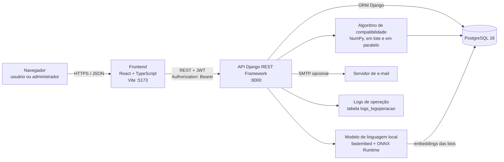
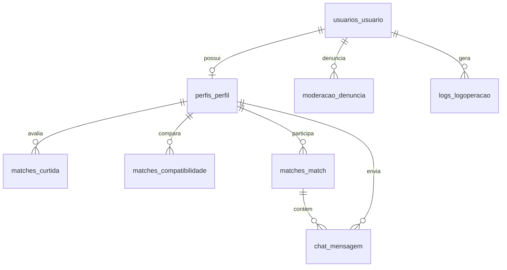

# Manual Técnico — PlaceMatch

**Versão do sistema:** v1.0.0  
**Grupo 07 — Turma 8 NA — Ciência da Computação (UNINASSAU) — Fábrica de Software e Tópicos Avançados, 2026.2**  
**Repositório:** https://github.com/Math-Lins/PlaceMatch

Este manual reúne o que uma pessoa desenvolvedora precisa para entender, instalar, executar e manter o PlaceMatch. Os comandos de dia a dia estão também no [README](../README.md); a referência completa das rotas está em [`docs/api.md`](./api.md).

---

## Sumário

1. [Visão geral da arquitetura](#1-visão-geral-da-arquitetura)
2. [Tecnologias, linguagens e bibliotecas](#2-tecnologias-linguagens-e-bibliotecas)
3. [Organização dos módulos e componentes](#3-organização-dos-módulos-e-componentes)
4. [Estrutura do banco de dados](#4-estrutura-do-banco-de-dados)
5. [Requisitos de ambiente e dependências](#5-requisitos-de-ambiente-e-dependências)
6. [Instalação e configuração](#6-instalação-e-configuração)
7. [Variáveis de ambiente e serviços](#7-variáveis-de-ambiente-e-serviços)
8. [Como executar](#8-como-executar)
9. [APIs e integração](#9-apis-e-integração)
10. [Componente de processamento: algoritmo de compatibilidade](#10-componente-de-processamento-algoritmo-de-compatibilidade)
11. [Segurança](#11-segurança)
12. [Testes e verificações](#12-testes-e-verificações)
13. [Manutenção e continuidade do desenvolvimento](#13-manutenção-e-continuidade-do-desenvolvimento)
14. [Problemas comuns](#14-problemas-comuns)

---

## 1. Visão geral da arquitetura

O PlaceMatch é uma aplicação web em três camadas:

- **Frontend:** SPA (aplicação de página única) em React + TypeScript, servida pelo Vite. Conversa com a API apenas por HTTP/JSON.
- **Backend:** API REST em Django + Django REST Framework, autenticação JWT, documentação OpenAPI.
- **Banco de dados:** PostgreSQL 16, com as regras de negócio principais protegidas por restrições `CHECK`.



**Fluxo típico de uma requisição:**

1. O frontend chama a API com o token de acesso no cabeçalho `Authorization: Bearer <access>`.
2. O DRF autentica o token (simplejwt), confere a permissão da rota (por tipo de usuário) e valida a entrada.
3. A view executa a regra de negócio (normalmente em `servicos.py`), grava no banco e registra a operação no log.
4. A resposta volta em JSON. Erros sempre em português, no formato `{"detail": "mensagem"}` ou `{"campo": ["mensagem"]}`.
5. Se o token de acesso venceu (1 hora), o frontend usa o token de renovação (7 dias) uma vez e repete a chamada; se a renovação falhar, mostra "Sua sessão expirou. Entre novamente.".

**Atualizações em "tempo quase real":** o chat e o contador de notificações usam consulta periódica (polling a cada 4 segundos na conversa aberta), sem WebSocket.

## 2. Tecnologias, linguagens e bibliotecas

| Camada | Tecnologia | Versão | Uso |
|---|---|---|---|
| Linguagem do backend | Python | 3.12+ (desenvolvimento: 3.14; Docker: 3.13) | — |
| Framework web | Django | 6.1.1 | ORM, migrações, administração, configurações |
| API | Django REST Framework | 3.18.1 | Views, serializers, permissões, paginação |
| Autenticação | djangorestframework-simplejwt | 5.5.1 | JWT (access 1 h, refresh 7 dias, rotação e lista de bloqueio) |
| Documentação da API | drf-spectacular | 0.30.0 | OpenAPI 3 + Swagger UI |
| CORS | django-cors-headers | 4.9.0 | Liberar o frontend |
| Banco | PostgreSQL + psycopg2-binary | 16 / 2.9.13 | Persistência |
| Processamento | NumPy | 2.x | Cálculo de compatibilidade em lote |
| Afinidade por IA | fastembed + ONNX Runtime | 0.9.1 / 1.32.0 | Modelo de linguagem local (`paraphrase-multilingual-MiniLM-L12-v2`, 384 dimensões) que compara as bios; sem PyTorch e sem serviço externo |
| Processamento paralelo | concurrent.futures + threadpoolctl | (biblioteca padrão) / 3.8.0 | Recálculo completo em vários núcleos (processos ou threads); `threadpoolctl` limita o BLAS a 1 thread por worker |
| Gráfico do benchmark | matplotlib | 3.11.2 | Só desenvolvimento (`requirements-dev.txt`): gera `docs/benchmark/paralelismo.png` |
| Configuração | python-dotenv | 1.2.3 | Leitura do `.env` |
| Linguagem do frontend | TypeScript | 5.9 | — |
| Interface | React | 19.3 | Componentes e estado |
| Build | Vite + Tailwind CSS | 8.3 / 4.3 | Servidor de desenvolvimento, build e estilos |
| Fontes | @fontsource (Outfit e Nunito) | 5.3.0 | Fontes servidas pelo próprio projeto |
| Testes de navegação | Playwright | 1.65 | Roteiros e2e e capturas |
| Contêineres | Docker + Docker Compose | — | Banco, API e frontend em desenvolvimento |

Versões exatas: [`backend/requirements.txt`](../backend/requirements.txt) e [`frontend/package.json`](../frontend/package.json) / `package-lock.json`.

## 3. Organização dos módulos e componentes

### 3.1 Backend (`backend/`)

Cada app Django segue a mesma organização: `models.py` (tabelas), `serializers.py` (validação e formato JSON), `views.py` (rotas), `servicos.py` (regras de negócio, quando há), `urls.py`, `tests*.py` e `management/commands/` (comandos de terminal).

| App | Responsabilidade | Comandos |
|---|---|---|
| `placematch/` | Configurações (`settings.py`, `test_settings.py`), rotas principais, validação comum, mensagens, tratamento de exceções, limites de tentativas (`limites.py`), documentação da API (`api_docs.py`, exemplos reais) | — |
| `usuarios/` | Modelo de usuário (login por e-mail, tipo de conta), cadastro, login, logout, `/me`, recuperação de senha (`senha.py`) | `criar_admin`, `matriz_permissoes` |
| `perfis/` | Perfil de compatibilidade e anúncio do imóvel; um por usuário | `seed_perfis`, `seed_demo` |
| `matches/` | Algoritmo (`algoritmo/`), compatibilidades, curtidas, matches, Descoberta; recálculo automático (`signals.py`); recálculo completo em paralelo (`processamento.py`) | `recalcular_compatibilidades`, `benchmark_compatibilidade`, `benchmark_paralelismo`, `seed_matches` |
| `chat/` | Conversas e mensagens dentro de um match | `seed_mensagens` |
| `moderacao/` | Denúncias, decisão do administrador, suspensão e reativação | — |
| `painel/` | Dashboard, relatórios, lista de usuários, exportação CSV, filtros comuns | `verificar_banco` |
| `logs/` | Registro de operações (18 ações) e consulta/exportação | — |
| `ia/` | Afinidade por IA: serviço do modelo (`servico.py`, carga única e thread-safe, estados "carregando/disponível/indisponível"), aquecimento na subida do servidor (`aquecimento.py`), embeddings das bios (`embeddings.py`), temas de convivência (`temas.py`), explicação para a API (`explicacao.py`: afinidade, temas em comum e o campo `analise_ia` do próprio perfil), rotas de administrador | `baixar_modelo_ia`, `gerar_embeddings [--workers N]` |
| `painel/` (processamento) | `GET /api/admin/processamento/benchmark/`: devolve o resultado do `benchmark_paralelismo` para a aba IA do painel | — |
| `scripts/` | Geração dos exemplos reais da API e do `docs/api.md` | — |

### 3.2 Frontend (`frontend/src/`)

| Arquivo | Responsabilidade |
|---|---|
| `main.tsx` | Ponto de entrada; carrega fontes e estilos |
| `App.tsx` | Telas do usuário (início, login, cadastro, recuperação de senha, criação/edição de perfil, Descoberta, detalhe, matches, chat, notificações, Meu Perfil), navegação por `?screen=`, guarda de rotas e restauração da sessão |
| `ia.tsx` | Afinidade por IA para o usuário: painel "Por que vocês combinam" (7 critérios, peso efetivo, temas em comum), selo "✨ Interesses em comum" dos cards, temas da própria bio (Meu Perfil) e o "ⓘ Como a IA funciona" |
| `api.ts` | Cliente HTTP: tokens em `sessionStorage`, renovação automática, tradução de erros, download de CSV |
| `ui.tsx` | Componentes visuais comuns (`Botao`, `Campo`, `Selo`, `Modal`, estados de carregando/vazio/erro) e formatação pt-BR (moeda, datas) |
| `admin/` | Painel administrativo: `AdminPanel.tsx` (abas), `PainelTab`, `RelatoriosTab`, `LogsTab`, `UsuariosTab`, `ModeracaoTab`, `IATab` (status do modelo, laboratório e processamento paralelo), `graficos.tsx` (inclui o gráfico por número de workers) |
| `index.css` | Paleta e estilos globais (Tailwind) |

Testes de navegação em `frontend/e2e/` (15 roteiros `n01` a `n15` e o roteiro de capturas `tour-rc.spec.ts`, RC-01 a RC-50).

### 3.3 Navegação e permissões

As telas são escolhidas pelo parâmetro `?screen=` do endereço. A guarda de rotas do frontend impede visitante de abrir telas internas e usuário comum de abrir o painel; a API repete todas as verificações (o frontend nunca é a única barreira). A matriz completa "rota × perfil de acesso" é gerada pelo comando `matriz_permissoes`.

## 4. Estrutura do banco de dados

Oito tabelas do sistema, mais as internas do Django e a lista de bloqueio de tokens (`token_blacklist_*`):

| Tabela | Conteúdo |
|---|---|
| `usuarios_usuario` | Conta: e-mail (único sem diferenciar maiúsculas), tipo (`buscando_vaga`, `oferecendo_vaga`, `administrador`), `is_active` (falso = suspensa) |
| `perfis_perfil` | Perfil e anúncio: idade, região, orçamento, tipo de imóvel, moradores, fumante, pets, visitas, horário, 4 escalas de hábitos, título, descrição, fotos (links), foto do perfil |
| `matches_compatibilidade` | Score (0 a 1) entre dois perfis de tipos opostos (`perfil_a_id < perfil_b_id`) |
| `matches_curtida` | Avaliação (`curtir` ou `recusar`) de um perfil sobre outro |
| `matches_match` | Curtida mútua, com o score do momento |
| `chat_mensagem` | Mensagem dentro de um match; o remetente é um dos dois perfis do match |
| `moderacao_denuncia` | Denúncia, motivo, status (`pendente`, `resolvida`, `descartada`) e decisão |
| `logs_logoperacao` | Trilha de auditoria (ação, usuário, entidade, IP, detalhes sem dados sensíveis) |
| `ia_embeddingperfil` | Embedding da bio (384 floats em 1536 bytes), modelo, hash do texto, temas detectados e tempo de geração; um por perfil |



**Integridade:** 28 restrições `CHECK` (idade 18–100, orçamento mínimo ≤ máximo, escalas 1–5, tamanhos de texto, valores válidos de listas, ninguém avalia ou denuncia a si mesmo) e índice único sobre `lower(email)`. Regras que envolvem várias tabelas (match só com curtida mútua, remetente participa do match, avaliação só entre tipos opostos, administrador sem perfil) são garantidas pela API e conferidas pelo comando `verificar_banco` (14 verificações, somente leitura).

Dicionário completo: [`docs/banco-de-dados.md`](./banco-de-dados.md). Esquema exportado: [`docs/esquema.sql`](./esquema.sql).

## 5. Requisitos de ambiente e dependências

| Requisito | Versão |
|---|---|
| Git | qualquer recente |
| Docker Desktop | para o PostgreSQL (e, opcionalmente, API e frontend) |
| Python | 3.12 ou superior (exigência do Django 6.1) |
| Node.js | 20.19+ ou 22.12+ (exigência do Vite 8) |
| Navegador | Chrome, Edge ou Firefox atualizados |

Memória: os testes de navegação (Playwright) consomem bastante memória; rode um roteiro por vez em máquinas com pouca RAM.

## 6. Instalação e configuração

```bash
git clone https://github.com/Math-Lins/PlaceMatch.git
cd PlaceMatch

# Backend
cd backend
cp .env.example .env            # Windows PowerShell: Copy-Item .env.example .env
#   edite SECRET_KEY (32+ caracteres) e DB_PASSWORD
python -m venv venv
source venv/bin/activate        # Windows: venv\Scripts\activate
pip install -r requirements.txt
docker compose up -d db         # PostgreSQL 16 no Docker
python manage.py migrate        # tabelas e restrições
python manage.py criar_admin    # conta de administrador (ADMIN_EMAIL / ADMIN_SENHA do .env)
python manage.py seed_demo      # opcional: dados de demonstração (somente em banco local)

# Frontend
cd ../frontend
cp .env.example .env            # VITE_API_URL (padrão http://127.0.0.1:8000)
npm install
```

Para gerar uma `SECRET_KEY`: `python -c "import secrets; print(secrets.token_urlsafe(48))"`.

## 7. Variáveis de ambiente e serviços

Os valores reais ficam **somente** nos arquivos `.env`, que não são versionados. Os modelos sem valores reais são `backend/.env.example` e `frontend/.env.example`.

| Variável (backend) | Para que serve |
|---|---|
| `SECRET_KEY` | Chave do Django e do JWT (mínimo 32 caracteres) |
| `DEBUG` | `True` só em desenvolvimento; padrão `False` |
| `ALLOWED_HOSTS` | Hosts aceitos pela API |
| `DB_NAME`, `DB_USER`, `DB_PASSWORD`, `DB_HOST`, `DB_PORT` | Conexão com o PostgreSQL |
| `ADMIN_EMAIL`, `ADMIN_SENHA` | Usados pelo comando `criar_admin` |
| `LOGIN_LIMITE_IP`, `LOGIN_LIMITE_EMAIL` | Limite de tentativas de login que falham (padrão `5/min` e `10/hour`) |
| `SENHA_LIMITE_EMAIL`, `SENHA_LIMITE_IP` | Limite de pedidos de link de senha (padrão `3/15min` e `10/hour`) |
| `PROXIES_CONFIAVEIS` | Quantos proxies confiáveis há na frente da API (para o IP real) |
| `FRONTEND_URL` | Endereço do frontend usado no link de redefinição de senha |
| `EMAIL_HOST`, `EMAIL_PORT`, `EMAIL_HOST_USER`, `EMAIL_HOST_PASSWORD`, `EMAIL_USE_TLS`, `DEFAULT_FROM_EMAIL` | Envio de e-mail por SMTP. Sem `EMAIL_HOST`, o e-mail é impresso no console do servidor |
| `IA_HABILITADA` | Liga o 7º critério (Afinidade por IA). `False` = só os 6 critérios, pesos renormalizados (padrão `True`) |
| `IA_MODELO_DIR` | Pasta do modelo baixado por `baixar_modelo_ia` (vazio = `backend/.modelos/`, fora do Git) |
| `IA_AQUECIMENTO` | Carrega o modelo em segundo plano quando o servidor sobe (padrão `True`; nunca em testes ou outros comandos) |
| `IA_EMBEDDER` | Só nos testes automatizados (`falso`, determinístico); não use em desenvolvimento nem em produção |
| `PROCESSAMENTO_WORKERS` | Workers do `recalcular_compatibilidades` em paralelo (vazio = `min(4, núcleos)`) |
| `PROCESSAMENTO_BENCHMARK_ARQUIVO` | Arquivo servido em `GET /api/admin/processamento/benchmark/` (vazio = `docs/benchmark/paralelismo.json`) |
| `SECURE_SSL_REDIRECT`, `SECURE_HSTS_SECONDS`, `SESSION_COOKIE_SECURE`, `CSRF_COOKIE_SECURE`, `SECURE_PROXY_SSL_HEADER`, `CORS_ALLOWED_ORIGINS` | Somente produção (HTTPS e origem do frontend) |

| Variável (frontend) | Para que serve |
|---|---|
| `VITE_API_URL` | Endereço da API (padrão `http://127.0.0.1:8000`) |

**Serviços necessários:** PostgreSQL 16. **Modelo de IA:** baixado uma vez com `python manage.py baixar_modelo_ia` (~241 MB em disco, ~560 MB de RAM por processo); sem ele, o sistema funciona com os 6 critérios. **Opcional:** servidor SMTP para o e-mail de recuperação de senha (por exemplo, Gmail com senha de app). Nunca coloque credenciais no código, no README ou em commits.

## 8. Como executar

| O quê | Comando | Endereço |
|---|---|---|
| Banco | `cd backend && docker compose up -d db` | localhost:5433 |
| API (local) | `cd backend && python manage.py runserver` | http://127.0.0.1:8000 |
| API (Docker, com banco) | `cd backend && docker compose up --build` | http://localhost:8000 |
| Frontend | `cd frontend && npm run dev` | http://localhost:5173 |
| Swagger (com `DEBUG=True`) | — | http://localhost:8000/api/docs/ |

Build de produção do frontend: `npm run build` (gera `frontend/dist`). Orientações de publicação (gunicorn, HTTPS, proxy, cache compartilhado) estão no README, seção "Implantação em produção".

## 9. APIs e integração

A API segue REST com JSON e está documentada em três formas: Swagger UI interativo (`/api/docs/`), schema OpenAPI 3 (`/api/schema/` e [`docs/openapi.yaml`](./openapi.yaml)) e referência em texto com exemplos reais ([`docs/api.md`](./api.md)). São **35 operações em 30 rotas**, em nove grupos:

| Grupo | Rotas principais |
|---|---|
| Autenticação | `POST /api/auth/registrar/`, `login/`, `login/refresh/`, `logout/`, `senha/solicitar/`, `senha/redefinir/`; `GET /api/auth/me/` |
| Perfis | `GET/POST /api/perfis/`; `GET/PUT/PATCH/DELETE /api/perfis/{id}/` |
| Perfis (IA) | `GET /api/perfis/` traz `analise_ia` no próprio perfil (situação e temas que a IA encontrou na bio) |
| Descoberta e Matches | `GET /api/descoberta/` (filtros e ordenação; `afinidade_ia` e `temas_em_comum` em cada card), `POST /api/curtidas/`, `GET /api/matches/`, `GET /api/compatibilidade/{perfil_id}/` (os 7 critérios, peso efetivo e temas) |
| Chat | `GET /api/conversas/`; `GET/POST /api/matches/{match_id}/mensagens/` |
| Moderação | `POST /api/moderacao/denuncias/`; rotas `/api/admin/moderacao/...` para listar, decidir, suspender e reativar |
| Painel | `GET /api/admin/dashboard/`, `relatorios/`, `relatorios/{rel_id}/` (JSON ou CSV), `usuarios/`, `usuarios/exportar/` |
| Afinidade por IA | `GET /api/admin/ia/status/` (situação do modelo), `POST /api/admin/ia/testar/` (comparar dois textos; 503 sem o modelo) |
| Processamento em lote | `GET /api/admin/processamento/benchmark/` (resultado do benchmark de paralelismo; 404 sem o arquivo) |
| Logs | `GET /api/admin/logs/`, `logs/exportar/` |

**Convenções:**

- Autenticação: obtenha `access` e `refresh` em `/api/auth/login/` e envie `Authorization: Bearer <access>`.
- Datas de filtro em `AAAA-MM-DD`, período máximo de 366 dias, a partir de 2000.
- Listas do painel paginadas por `page` e `page_size`.
- CSV com separador `;`, datas `dd/mm/aaaa`, vírgula decimal e células protegidas contra fórmulas.
- Códigos: `400` (dados inválidos), `401` (sem login ou token inválido), `403` (sem permissão), `404` (não encontrado), `429` (muitas tentativas), `503` (só no teste da IA, quando o modelo está fora do ar). Nenhuma entrada deve gerar `500`.

Um teste automatizado compara as rotas documentadas com as rotas reais e falha se alguma faltar ou sobrar.

## 10. Componente de processamento: algoritmo de compatibilidade

O núcleo de processamento do PlaceMatch é o **algoritmo de compatibilidade**, que transforma as respostas do perfil num score entre 0 e 1 (exibido como porcentagem) e ordena a Descoberta.

**Critérios e pesos** (`backend/matches/algoritmo/config.py`):

| Critério | Peso | Como é medido |
|---|---|---|
| Orçamento | 23% | Sobreposição das faixas de preço |
| Hábitos | 22% | Fumante, pets, visitas e escalas de bagunça, organização e vida social |
| Região | 14% | Mesma região/bairro (comparação normalizada) |
| Rotina | 14% | Perfil de horário (tabela de similaridade) e tolerância a barulho |
| Moradia | 9% | Tipo de imóvel (tabela de similaridade) e número de moradores |
| Idade | 8% | Diferença de idade (zero a partir de 20 anos) |
| Afinidade de interesses (IA) | 10% | Cosseno entre os embeddings das bios (modelo de linguagem local), calibrado para 0 a 1. Sem bio suficiente (20+ letras) ou com a IA desligada, sai do cálculo e os outros 6 pesos são renormalizados |

**Implementação:**

- `algoritmo/escalar.py`: cálculo de um par, usado como referência.
- `algoritmo/vetorial.py`: cálculo em lote com **NumPy** (um perfil contra todos os do tipo oposto), usado em produção; um teste garante resultado idêntico ao escalar.
- `signals.py`: ao criar ou editar um perfil, os scores dele são recalculados automaticamente e gravados em `matches_compatibilidade` com **2 consultas ao banco**, independentemente do número de perfis.
- `algoritmo/matriz.py` + `algoritmo/paralelo.py` + `processamento.py`: recálculo **completo** (todos os pares) em blocos de 256 × 256 pares, nos modos sequencial, threads ou processos; resultado idêntico ao escalar com qualquer número de workers.
- Comandos: `recalcular_compatibilidades [--modo auto|processos|threads|sequencial] [--workers N]` (recalcula tudo), `benchmark_compatibilidade` (loop × NumPy) e `benchmark_paralelismo` (speedup, eficiência e Lei de Amdahl; grava `docs/benchmark/paralelismo.*`). Os dois benchmarks só usam banco com `--banco-descartavel` (banco vazio).

**Desempenho medido:** com banco, o cálculo em lote (1 perfil contra todos) é **26× a 34× mais rápido** que a versão item a item (100 a 5.000 perfis, já com a IA), principalmente por trocar N+1 consultas por 2. No recálculo completo em paralelo (benchmark de 1.000 a 20.000 perfis, i3 de 2 núcleos com outros programas abertos), threads chegaram a **2,4×**. Processos perderam até 5.000 perfis, por causa de ~3 s para subir os workers no Windows. Ponta a ponta, gravar no banco é 99,8% do tempo (Lei de Amdahl). Detalhes na seção 12 de [`algoritmo-compatibilidade.md`](./algoritmo-compatibilidade.md) e na aba IA do painel.

**Limitações conhecidas:** a região é comparada por igualdade de texto normalizado (grafias diferentes não combinam); scores de pares que não envolvem o perfil alterado não são recalculados em cascata; a IA mede o **assunto** das bios, não a posição ("durmo tarde" × "acordo cedo" falam do mesmo assunto), por isso tem só 10% e a posição fica com hábitos e rotina. Detalhes, fórmulas e tabelas: [`docs/algoritmo-compatibilidade.md`](./algoritmo-compatibilidade.md) e [`docs/benchmark/`](./benchmark/).

## 11. Segurança

- Senhas com hash PBKDF2 do Django; regras de senha forte no cadastro e na redefinição.
- JWT com expiração (1 h / 7 dias), rotação do token de renovação e lista de bloqueio no logout e na redefinição de senha.
- Limite de tentativas de login (`429`) e de pedidos de link de senha (resposta neutra).
- Permissões verificadas em todas as rotas; conta suspensa não entra e some da Descoberta, dos matches e do chat.
- Logs sem senhas, tokens, links ou texto de mensagens.
- CSVs protegidos contra injeção de fórmula.
- `DEBUG` desligado por padrão; Swagger aberto só em desenvolvimento.
- Segredos apenas em `.env` (fora do Git).

O relatório de auditoria está em [`docs/auditoria-rc.md`](./auditoria-rc.md).

## 12. Testes e verificações

| Verificação | Comando | Resultado na v1.0.0 |
|---|---|---|
| Testes do backend | `python manage.py test --settings=placematch.test_settings` | 824 testes OK (nenhum pulado; o teste com o modelo real de IA roda quando ele está baixado) |
| Migrações em dia | `python manage.py makemigrations --check --dry-run --settings=placematch.test_settings` | Sem alterações |
| Permissões | `python manage.py matriz_permissoes --settings=placematch.test_settings` | Sem divergências |
| Contrato da API | `python manage.py spectacular --validate --fail-on-warn --file ../docs/openapi.yaml --settings=placematch.test_settings` | Sem avisos |
| Consistência do banco | `python manage.py verificar_banco` | 0 erros |
| Análise estática | `ruff check .` (backend) | Sem erros |
| Tipos e build | `npx tsc --noEmit --noUnusedLocals --noUnusedParameters` e `npm run build` | Sem erros |
| Navegação (Playwright) | `npm run e2e:db`, `npm run e2e`, `npm run e2e:db:parar` | 15 roteiros, 31 testes (um roteiro por vez, com o modelo de IA real) |
| Prints da interface | `npm run e2e:tour` | RC-01 a RC-50 (RC-43 a RC-50: IA e processamento paralelo) |

As saídas completas da última execução estão em [`docs/execucoes-rc/`](./execucoes-rc/).

## 13. Manutenção e continuidade do desenvolvimento

**Fluxo de trabalho:**

1. Atualize o código (`git pull`) e rode `python manage.py migrate`.
2. Faça a mudança com teste (o backend usa `django.test`; o frontend, roteiros Playwright).
3. Rode a suíte do backend, `tsc` e `build`; rode os roteiros e2e das telas afetadas.
4. Faça commit no padrão adotado (`feat:`, `fix:`, `docs:`, `test:`, `chore:`), sem `.env` e sem credenciais.

**Tarefas frequentes:**

| Quero… | Onde mexer |
|---|---|
| Mudar pesos ou tabelas do score | `backend/matches/algoritmo/config.py`; depois `python manage.py recalcular_compatibilidades` |
| Mudar os temas da IA ou a calibração | `backend/ia/temas.py` e `matches/algoritmo/config.py`; depois `python manage.py gerar_embeddings --forcar` |
| Medir o paralelismo de novo | `python manage.py benchmark_paralelismo` (com a máquina ociosa); a aba IA do painel lê o resultado |
| Novo campo no perfil | `perfis/models.py` → `makemigrations`/`migrate` → `perfis/serializers.py` → formulário em `App.tsx` → algoritmo, se influenciar o score → `docs/banco-de-dados.md` |
| Nova rota da API | `views.py` + `urls.py` do app, permissão, testes, anotação `@extend_schema` e regeneração de `docs/api.md` e `docs/openapi.yaml` (scripts em `backend/scripts/`) |
| Nova ação de log | `logs/models.py` (`ACAO_CHOICES`) + migração + rótulo no filtro da aba Logs |
| Novo relatório | `painel/views.py` (`RELATORIOS`) e exportação em `painel/exportacao.py` |
| Novo texto ou mensagem de erro | Mensagens da API em português (`placematch/mensagens.py` e serializers); textos da interface em `App.tsx` |
| Dados de demonstração | `perfis/management/commands/seed_demo.py` (somente para banco local) |

**Melhorias recomendadas para versões futuras:** dividir `frontend/src/App.tsx` (arquivo grande) em telas separadas; chat em tempo real (WebSocket); envio de e-mail em segundo plano; cache compartilhado (Redis) para os limites de tentativas; normalização de regiões para o score; envio de fotos como arquivo (hoje são links).

## 14. Problemas comuns

| Sintoma | Causa provável | Solução |
|---|---|---|
| `password authentication failed for user placematch_user` | Senha do `.env` diferente da do volume do PostgreSQL | Veja [`docs/runbook-docker.md`](./runbook-docker.md) |
| A API não sobe com `DEBUG=False` | `SECRET_KEY` ausente ou curta | Defina uma chave com 32+ caracteres |
| Swagger pede login | `DEBUG=False` | Use `DEBUG=True` em desenvolvimento ou entre como administrador |
| Frontend mostra erro de conexão | API desligada ou `VITE_API_URL` errado | Suba a API e confira o `.env` do frontend |
| Erro de CORS | Frontend aberto em endereço não liberado | Use `http://localhost:5173` ou ajuste `CORS_ALLOWED_ORIGINS` |
| E-mail de senha não chega | Sem `EMAIL_HOST`, ou credenciais SMTP inválidas | Em desenvolvimento, veja o link no console; para envio real, configure SMTP com senha de app |
| `429` no login | Muitas tentativas erradas | Aguarde; em testes, ajuste `LOGIN_LIMITE_*` |
| Telas diferentes das capturas | Banco local com outros dados | Rode `python manage.py seed_demo` (em banco local) |
| Testes e2e travam ou caem | Pouca memória | Rode um roteiro por vez: `npm run e2e -- n06` |
