# Manual do Usuário — PlaceMatch

**Versão do sistema:** v1.0.0  
**Grupo 07 — Turma 8 NA — Ciência da Computação (UNINASSAU) — Fábrica de Software, 2026.2**

Este manual explica como usar o PlaceMatch, passo a passo, para quem nunca usou o sistema. As imagens são capturas da versão atual, feitas com os dados de demonstração (pessoas e anúncios fictícios de bairros do Recife).

---

## Sumário

1. [O que é o PlaceMatch](#1-o-que-é-o-placematch)
2. [Para quem é](#2-para-quem-é)
3. [Como acessar](#3-como-acessar)
4. [Criar conta, entrar e sair](#4-criar-conta-entrar-e-sair)
5. [Esqueci minha senha](#5-esqueci-minha-senha)
6. [Criar o seu perfil](#6-criar-o-seu-perfil)
7. [Menu e navegação](#7-menu-e-navegação)
8. [Descoberta: encontrar vagas ou pessoas](#8-descoberta-encontrar-vagas-ou-pessoas)
9. [Interesse mútuo (match)](#9-interesse-mútuo-match)
10. [Matches e conversas](#10-matches-e-conversas)
11. [Notificações](#11-notificações)
12. [Meu Perfil: ver, editar e excluir](#12-meu-perfil-ver-editar-e-excluir)
13. [Denunciar um usuário](#13-denunciar-um-usuário)
14. [Painel administrativo](#14-painel-administrativo)
15. [Uso no celular](#15-uso-no-celular)
16. [Mensagens, validações e situações comuns](#16-mensagens-validações-e-situações-comuns)
17. [Afinidade de interesses (IA)](#17-afinidade-de-interesses-ia)

---

## 1. O que é o PlaceMatch

O PlaceMatch ajuda pessoas a encontrar **com quem dividir moradia**. De um lado está quem **procura um lugar** para morar; do outro, quem **tem uma vaga** em casa, apartamento ou república.

Cada pessoa responde perguntas sobre orçamento, região, rotina e hábitos de convivência. Com essas respostas, o sistema calcula um **percentual de compatibilidade** entre quem procura e quem oferece, e mostra primeiro as opções que mais combinam. Quando as duas pessoas demonstram interesse uma na outra, acontece um **match** e elas podem conversar pelo chat do próprio sistema.

## 2. Para quem é

| Perfil | O que faz no sistema |
|---|---|
| **Procura um lugar** | Vê os anúncios de vagas compatíveis, demonstra interesse, conversa com quem anuncia. |
| **Tem um lugar disponível** | Cria o anúncio da vaga (com fotos), vê as pessoas interessadas compatíveis, demonstra interesse, conversa. |
| **Administrador** | Não participa da busca por moradia. Acompanha indicadores, gera relatórios, consulta o histórico de operações, gerencia contas e analisa denúncias. |

Quem procura vê apenas anúncios; quem oferece vê apenas pessoas que procuram. Ninguém vê perfis do mesmo tipo.

## 3. Como acessar

- Use um navegador atualizado (Chrome, Edge ou Firefox) no computador ou no celular.
- Em ambiente de desenvolvimento, o endereço é **http://localhost:5173** (o servidor precisa estar ligado; veja o Manual Técnico).
- Não é preciso instalar nada no computador de quem usa.

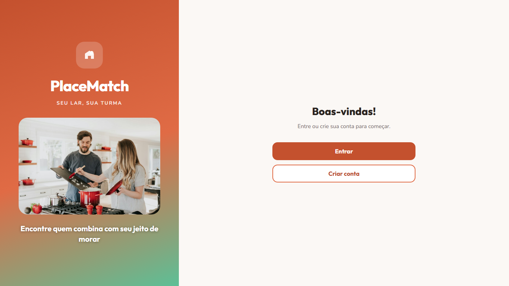

Na tela inicial há duas opções: **Entrar**, para quem já tem conta, e **Criar conta**.

## 4. Criar conta, entrar e sair

### 4.1 Criar conta

1. Na tela inicial, clique em **Criar conta**.
2. Preencha **Nome completo**, **E-mail**, **Senha** e **Confirmar senha**.
3. Em **Você está:**, escolha **Procuro um lugar** ou **Tenho um lugar disponível**. Essa escolha define o tipo da conta e não pode ser trocada depois.
4. Clique em **Continuar**. O sistema entra na conta automaticamente e abre a criação do perfil.

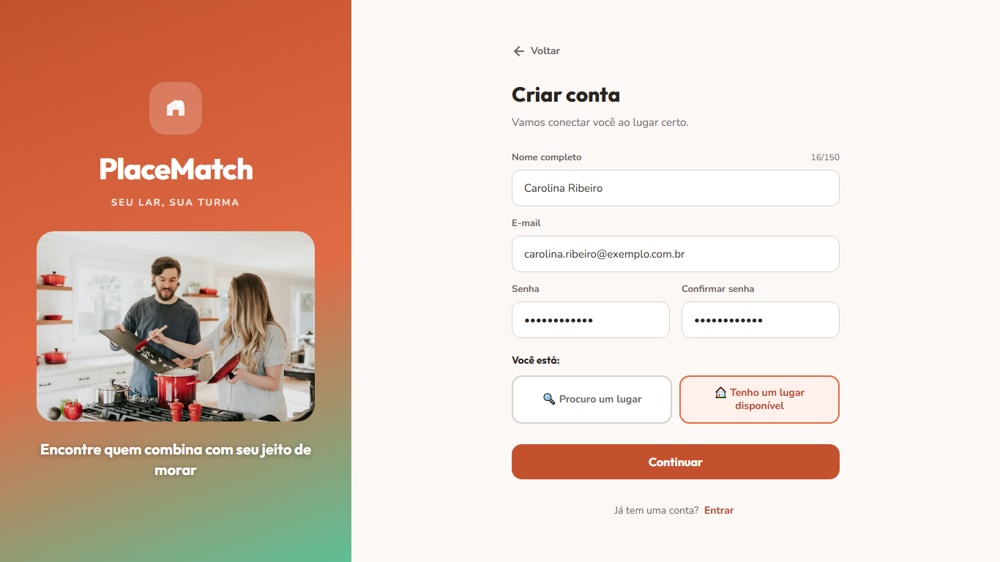

**Regras da senha:** no mínimo 8 caracteres; não pode ser só números; não pode ser uma senha muito comum (como "12345678"); não pode ser parecida demais com o nome ou com o e-mail.

### 4.2 Entrar

1. Clique em **Entrar**.
2. Informe **E-mail** e **Senha** e clique em **Entrar** (ou pressione Enter).

Se você já tem perfil, o sistema abre a Descoberta. Se ainda não terminou o perfil, abre a criação do perfil. O administrador vai direto para o Painel Admin.

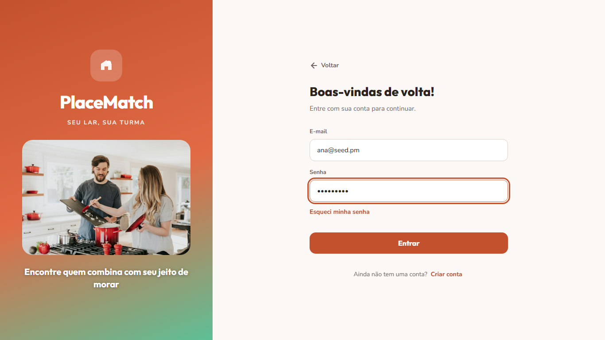

### 4.3 Sessão

- A sessão fica ativa enquanto a aba do navegador estiver aberta e é renovada automaticamente.
- Ao fechar a aba, é preciso entrar de novo.
- Se a sessão expirar, aparece **"Sua sessão expirou. Entre novamente."** e o sistema volta ao login.

### 4.4 Sair

Clique em **Sair da conta**, no rodapé do menu lateral (ou em Meu Perfil). A sessão é encerrada também no servidor.

### 4.5 Conta suspensa

Se a conta foi suspensa por um administrador, o login mostra **"Conta suspensa. Procure o suporte."** e não é possível entrar.

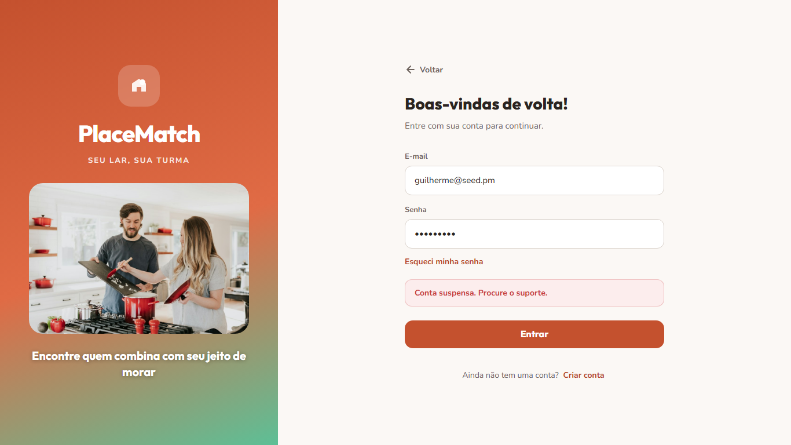

## 5. Esqueci minha senha

1. Na tela de login, clique em **Esqueci minha senha**.
2. Informe o e-mail da conta e clique em **Enviar link**.
3. Aparece a confirmação **"Se o e-mail estiver cadastrado, enviaremos um link para redefinir a senha."** A mensagem é sempre a mesma, por segurança: ela não revela se o e-mail tem conta.
4. Abra o e-mail e clique no link. **O link vale por 1 hora e só pode ser usado uma vez.**
5. Digite a **Nova senha** e **Confirmar nova senha** (mesmas regras do cadastro) e clique em **Redefinir senha**.
6. Pronto: aparece **"Senha redefinida!"**. Todas as sessões abertas da conta foram encerradas. Clique em **Entrar** e use a nova senha.

| 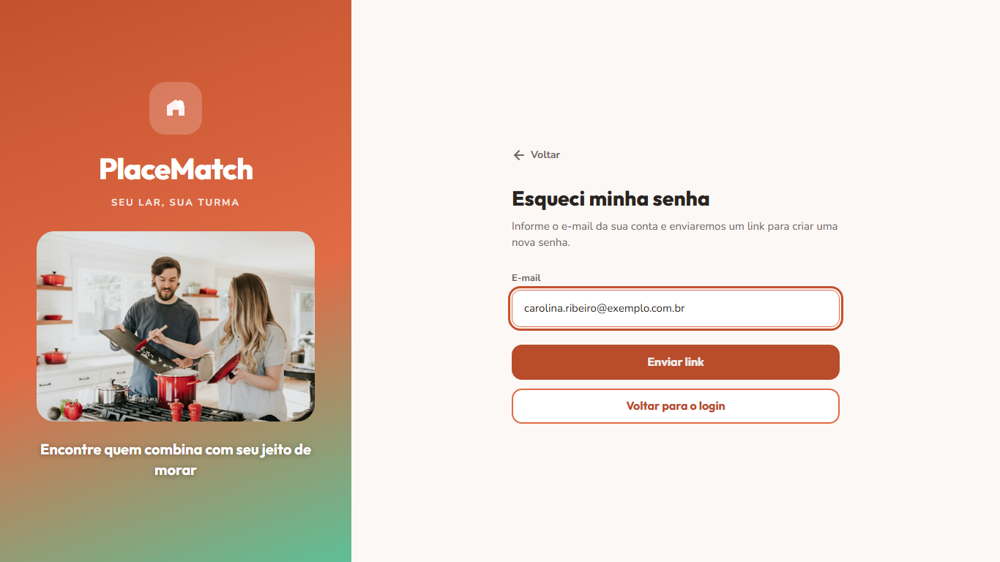 | 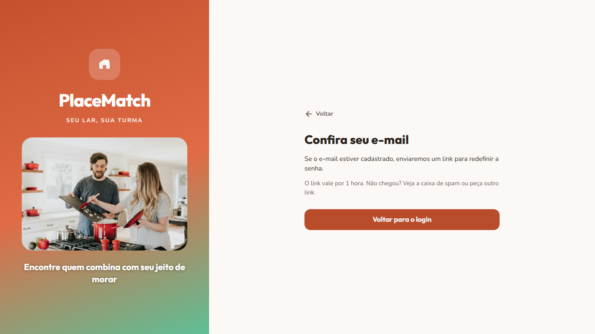 |
|---|---|
| 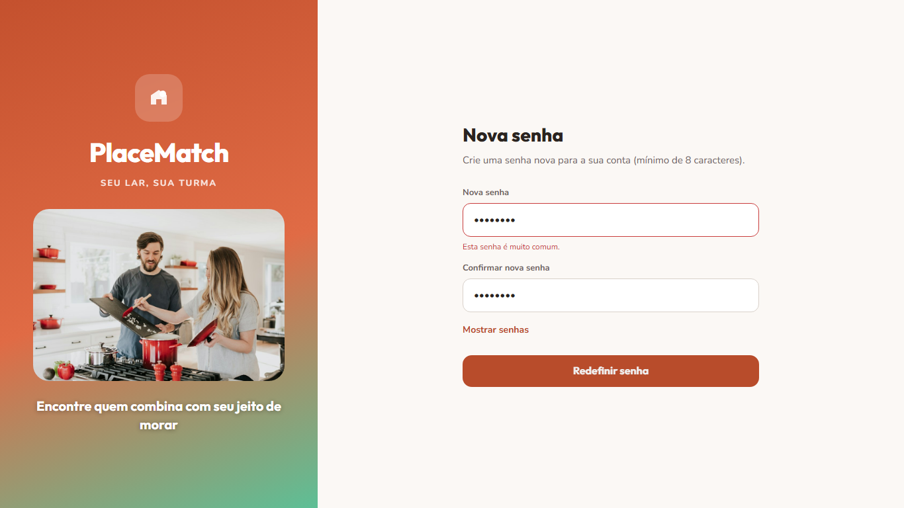 | 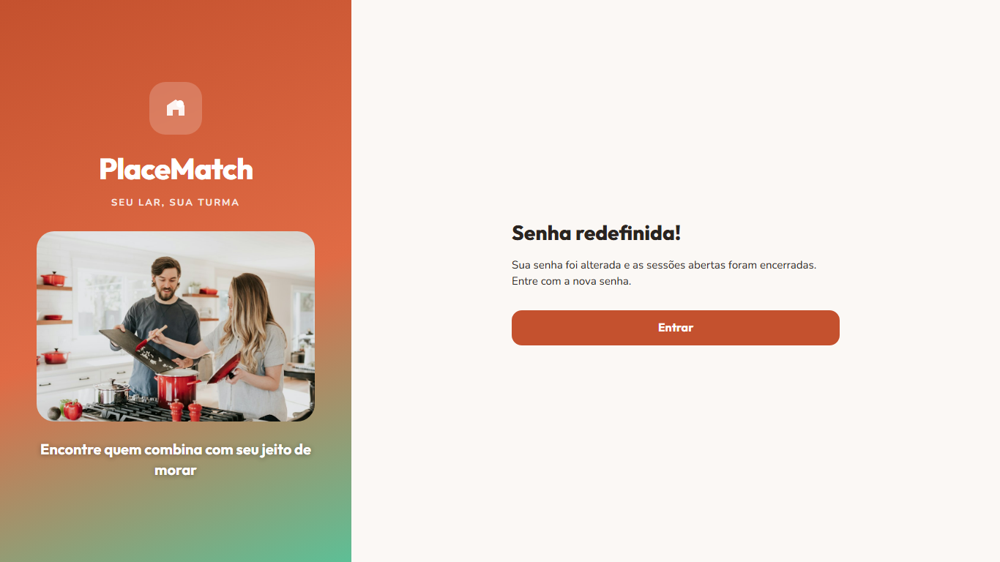 |

Se o link já foi usado ou expirou, aparece **"Link inválido ou expirado"**, com o botão **Pedir um novo link**.

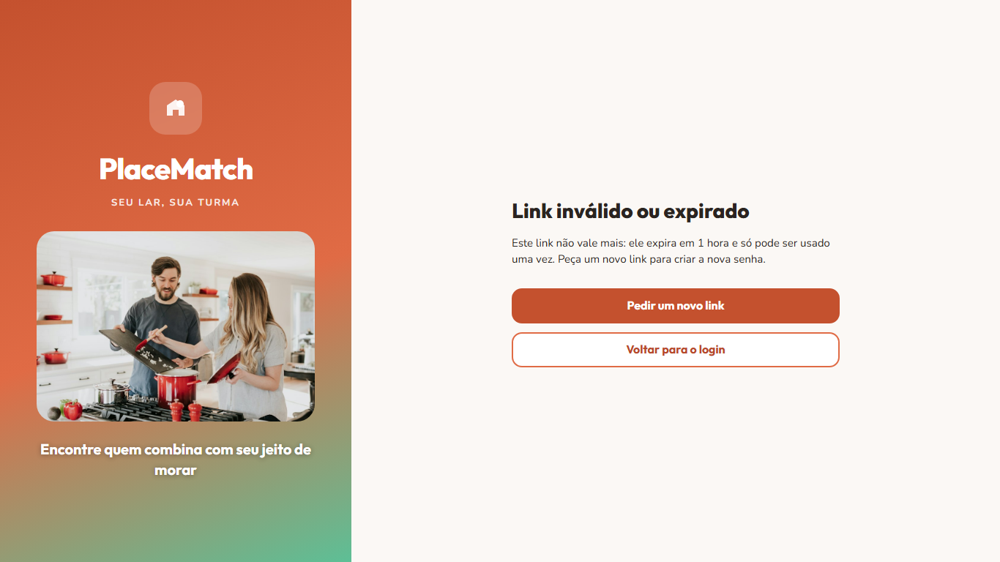

> **Observação:** na versão atual, em ambiente de desenvolvimento, o e-mail não é enviado de verdade: o link aparece no terminal do servidor. O envio real depende da configuração de uma conta de e-mail (veja o Manual Técnico).

## 6. Criar o seu perfil

Depois do cadastro, o sistema pede o perfil, em etapas. A barra no topo mostra **Etapa X de Y**. Quem procura um lugar preenche **4 etapas**; quem tem um lugar preenche **5** (a última é o anúncio). Use **Voltar** e **Próxima etapa** para navegar; o que já foi preenchido é mantido.

### Etapa 1 — Sobre você

- **Link da sua foto** (opcional): endereço de uma imagem começando com `http://` ou `https://`. Quando o link é válido, a foto aparece no círculo. Clicar no círculo leva ao campo do link.
- **Nome** (2 a 150 caracteres), **Idade** (18 a 100), **Região ou bairro** e **Sobre você** (até 500 caracteres).
- **Dica:** escreva em "Sobre você" o que você gosta de fazer (cozinhar, estudar, música, esportes…). A IA usa esse texto para encontrar pessoas com interesses parecidos ([seção 17](#17-afinidade-de-interesses-ia)).

### Etapa 2 — Preferências de moradia

- **Faixa de orçamento mensal**: mínimo e máximo, em reais. Pode digitar no formato brasileiro (por exemplo, `1.500` ou `2.000,50`). O máximo deve ser maior ou igual ao mínimo.
- **Tipo de imóvel preferido**: Apartamento, Casa, República ou Indiferente.
- **Quantas pessoas no imóvel**: 1, 2, 3 ou 4+.

### Etapa 3 — Estilo de convivência

- **Você fuma?** e **Aceita pets?** (Sim/Não).
- **Com que frequência recebe visitas?**: Raramente, Às vezes ou Frequentemente.
- **Qual é o seu perfil de horário?**: Madrugador(a), Noturno(a) ou Flexível.

### Etapa 4 — Seus hábitos

Escalas de **1 (mínimo) a 5 (máximo)** para **Organização**, **Tolerância à bagunça**, **Tolerância a barulho** e **Perfil social**.

### Etapa 5 — Anúncio do imóvel (só para quem tem um lugar)

**Título**, **Descrição** (até 1000 caracteres) e **até 5 fotos do imóvel por link**, com pré-visualização.

Ao final, clique em **Concluir perfil**. Se algum campo estiver errado, ele fica destacado em vermelho com a explicação, e o sistema volta para a etapa do erro.

| 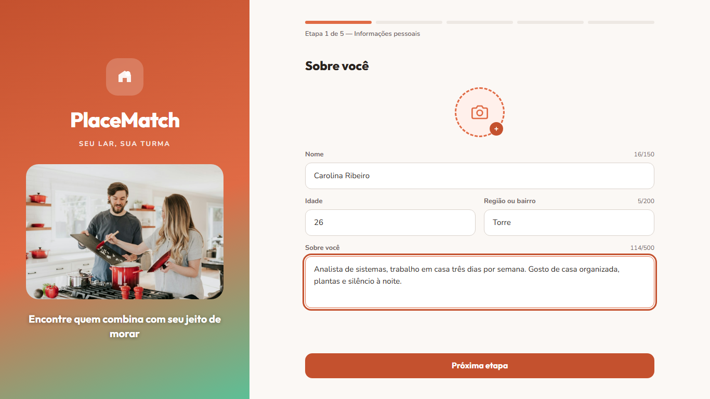 | 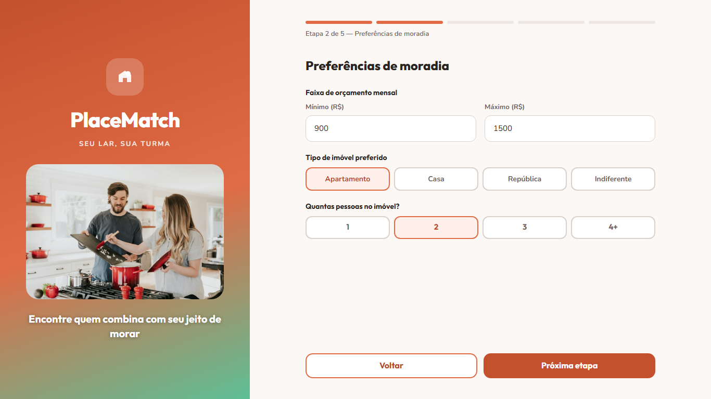 |
|---|---|
| 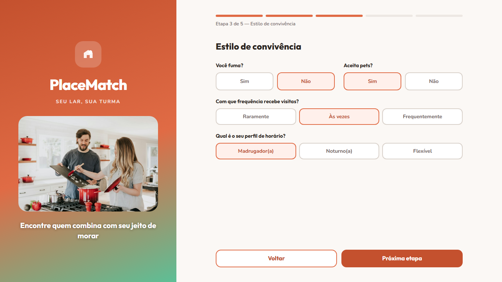 | 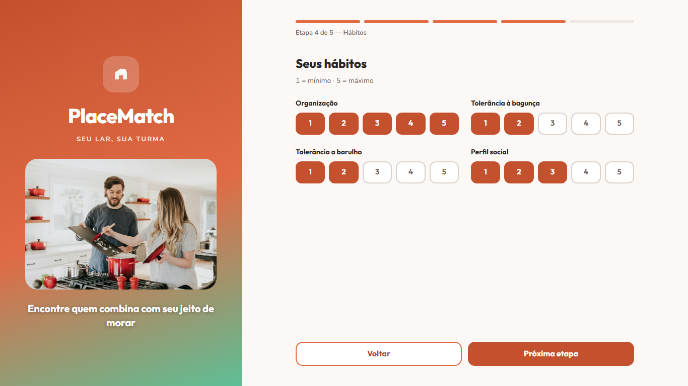 |

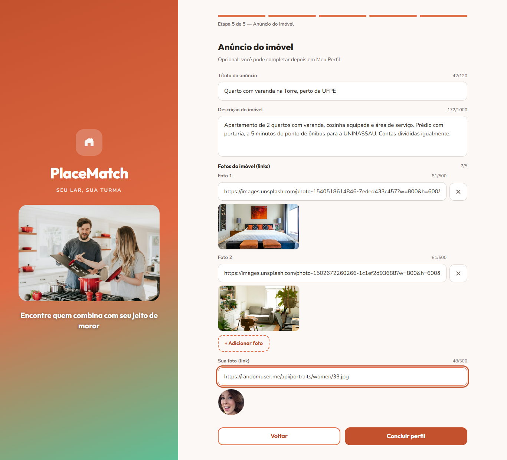

## 7. Menu e navegação

No computador, o menu fica à esquerda; no celular, numa barra na parte de baixo da tela.

| Item | Para que serve |
|---|---|
| **Descoberta** | Ver anúncios (ou pessoas interessadas) compatíveis. |
| **Notificações** | Ver novos matches. Um número vermelho indica novidades. |
| **Matches** | Ver as pessoas com quem houve interesse mútuo e conversar. |
| **Perfil** | Ver, editar ou excluir o seu perfil. |
| **Sair da conta** | Encerrar a sessão. |

O endereço da página acompanha a tela aberta: recarregar a página (F5) mantém você na mesma tela, inclusive dentro de uma conversa.

## 8. Descoberta: encontrar vagas ou pessoas

### 8.1 Cards

Quem procura um lugar vê **"Vagas para você"**: cada card traz foto do imóvel, título, bairro, tipo, número de pessoas, faixa de preço, etiquetas (Aceita pets, Não fumante…) e quem anunciou. Quem tem um lugar vê **"Interessados na sua vaga"**: cada card traz foto, nome, idade, bairro e etiquetas de hábitos.

Todo card mostra o **percentual de compatibilidade**. A lista vem ordenada do mais compatível para o menos compatível. Quando a IA percebe que as biografias falam dos mesmos interesses, o card ganha o selo **"✨ Interesses em comum: …"** (veja a [seção 17](#17-afinidade-de-interesses-ia)).

| 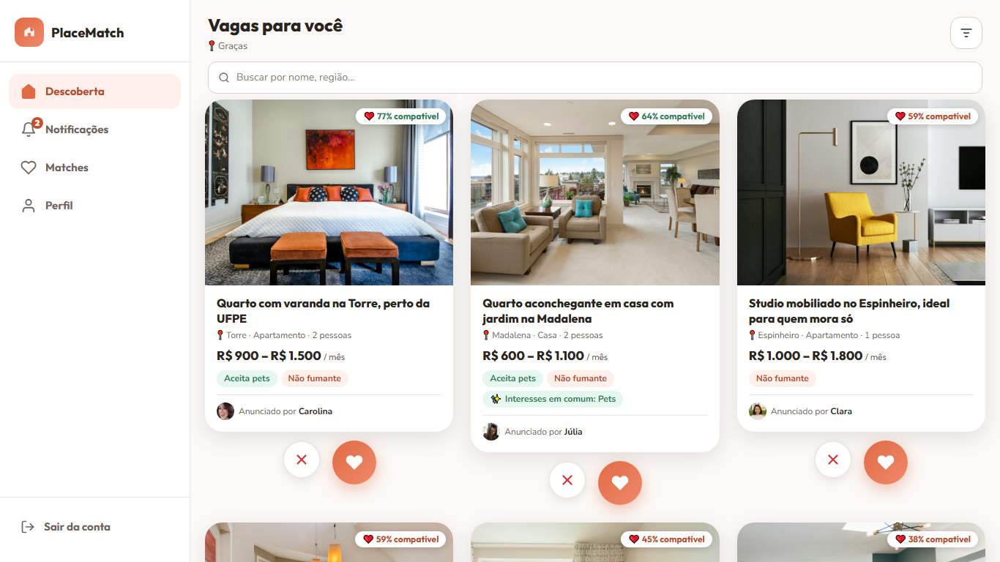 | 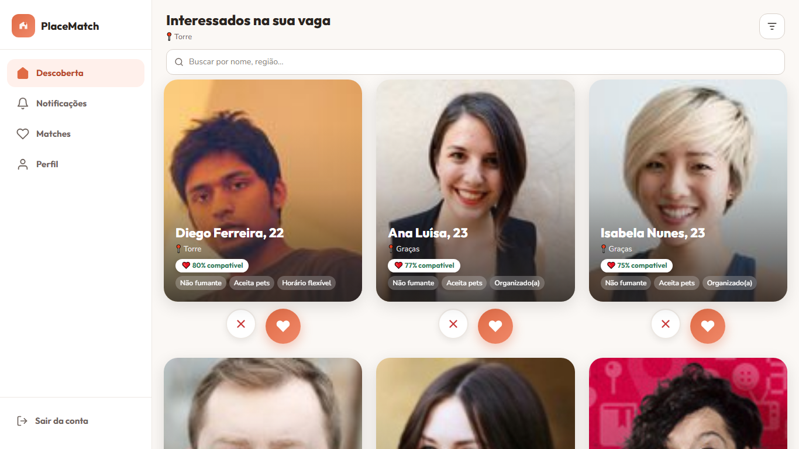 |
|---|---|

**Como ler a compatibilidade:**

| Percentual | Rótulo |
|---|---|
| 0% a 19% | Baixa compatibilidade |
| 20% a 39% | Compatibilidade regular |
| 40% a 59% | Boa compatibilidade |
| 60% a 79% | Alta compatibilidade |
| 80% a 100% | Combinação perfeita |

O percentual considera sete critérios: orçamento, hábitos, região, rotina, tipo de moradia, idade e a **afinidade de interesses (IA)**, que compara o que as duas pessoas escreveram em "Sobre você". Se uma das bios for curta demais, a IA fica de fora e o percentual usa só os outros seis, sem tirar pontos de ninguém.

### 8.2 Buscar e filtrar

- **Busca**: digite nome, região ou parte do título no campo **Buscar por nome, região…**.
- **Filtros** (ícone no canto superior direito): região, tipo de imóvel, aceita pets, fumante e faixa de orçamento. Clique em **Aplicar filtros**. Os filtros ativos aparecem como etiquetas (chips) que podem ser removidas uma a uma; **Limpar filtros** remove todos.
- **Ordenar**: Mais compatível, Menor preço ou Maior preço.

| 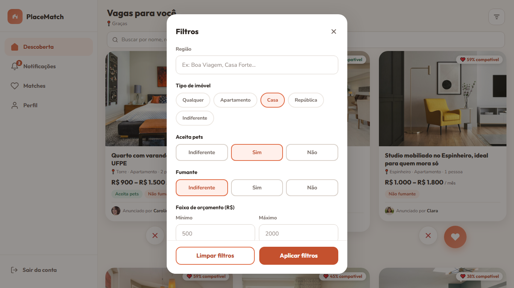 | 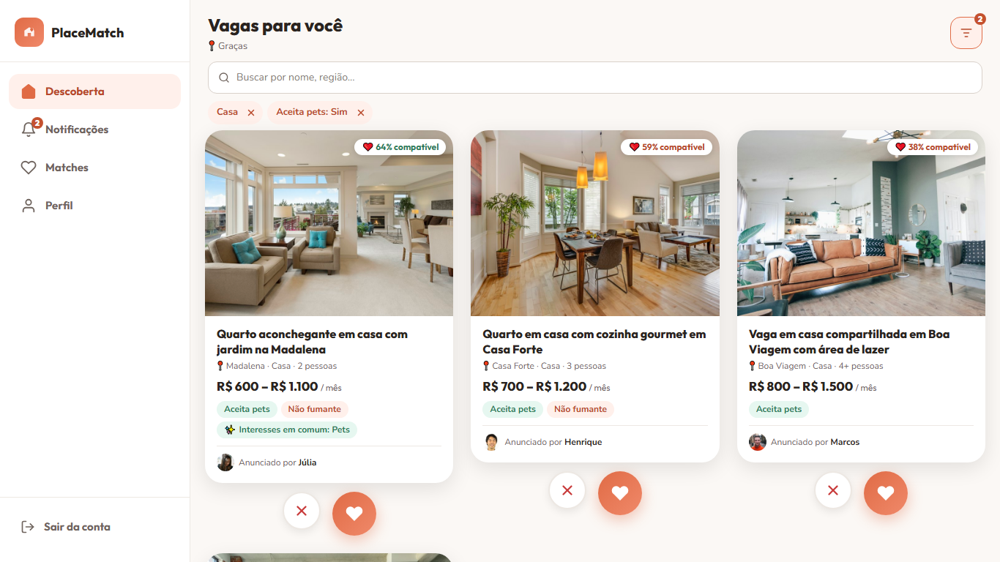 |
|---|---|

Se nenhum resultado aparecer, o sistema mostra **"Nenhum perfil com esses filtros."** com o botão **Limpar filtros**.

### 8.3 Ver detalhes, curtir e recusar

- Clique no card para ver o **detalhe**: fotos (clique nas miniaturas para trocar), preço, compatibilidade, descrição, o painel **"Por que vocês combinam"** (critério a critério, [seção 17](#17-afinidade-de-interesses-ia)), dados da vaga e quem anunciou.
- **Coração / Tenho interesse**: demonstra interesse.
- **X / Recusar**: tira a opção da sua lista.
- Cada perfil só pode ser avaliado uma vez.

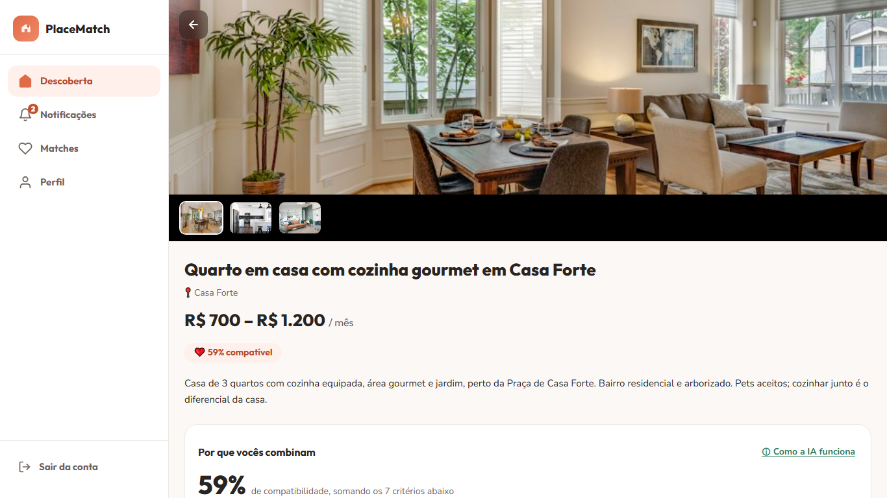

## 9. Interesse mútuo (match)

Quando você demonstra interesse em alguém que **já tinha demonstrado interesse em você**, aparece a tela **"Interesse mútuo confirmado"**. A partir daí, as duas pessoas aparecem em **Matches** e podem conversar. O interesse de uma só pessoa não é mostrado à outra.

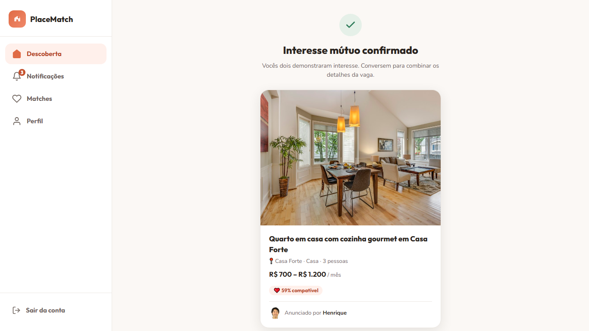

## 10. Matches e conversas

### 10.1 Lista de matches

Em **Matches**, cada card mostra foto, nome, idade, bairro, compatibilidade e a última mensagem (ou **"Diga olá!"**, se ainda não conversaram). O selo **"N novas"** indica mensagens não lidas. Use **Buscar conversa…** para procurar pelo nome e **Só não lidas** para filtrar.

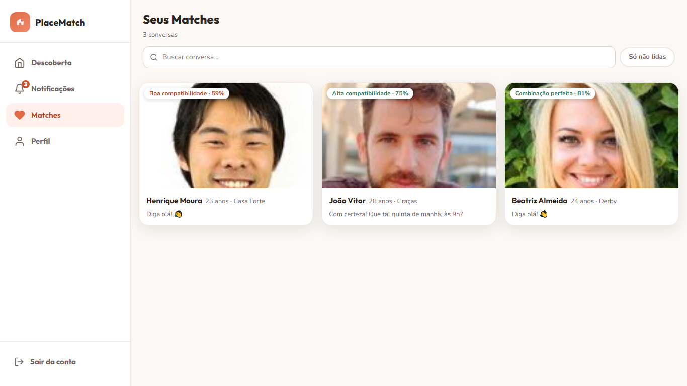

### 10.2 Chat

1. Clique no match para abrir a conversa.
2. Digite em **Digite uma mensagem…** e pressione Enter ou o botão de enviar.
3. Cada mensagem mostra data e hora. Suas mensagens ficam à direita, em laranja.

- As novas mensagens aparecem sozinhas, a cada poucos segundos.
- Limite de **1000 caracteres** por mensagem; mensagens vazias não são enviadas.
- Se a internet cair, aparece **"Sem conexão, tentando novamente…"**, que some quando a conexão volta.
- O menu **⋮** no topo da conversa tem as opções **Ver perfil** e **Denunciar**.

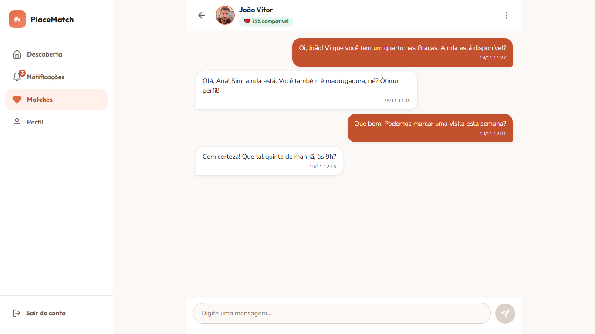

## 11. Notificações

A tela **Notificações** lista os novos matches, do mais recente para o mais antigo, com a compatibilidade e o atalho **Abrir conversa**. O número no menu indica quantas novidades existem.

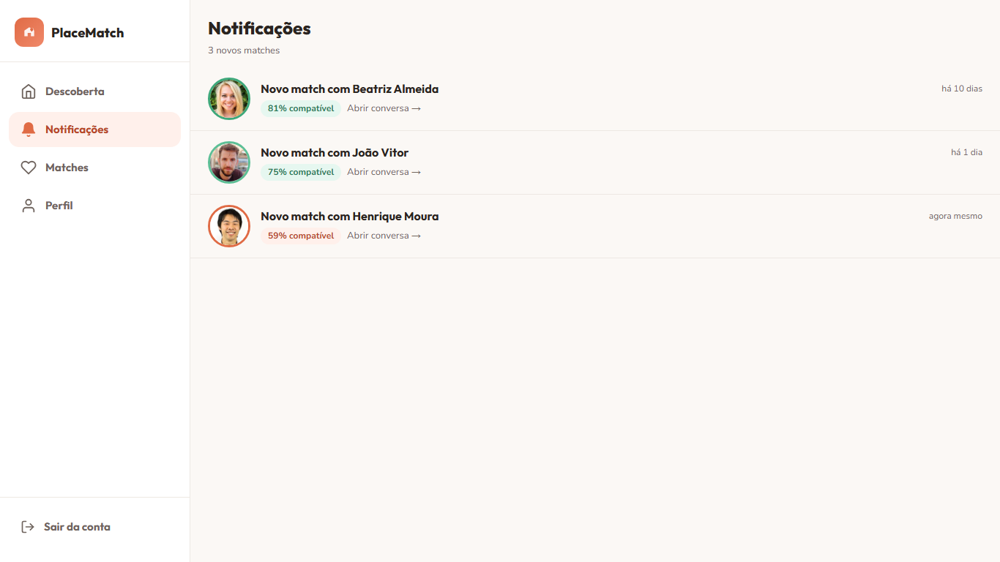

## 12. Meu Perfil: ver, editar e excluir

- **Ver**: em **Perfil**, aparecem todos os seus dados: sobre mim, os **temas que a IA identificou na sua bio**, preferências de moradia, convivência e hábitos (e o anúncio, para quem oferece vaga).
- **Editar**: clique em **Editar**, altere os campos (inclusive o link da foto) e clique em **Salvar**. **Cancelar** descarta as mudanças. As regras são as mesmas da criação.
- **Excluir**: clique em **Excluir perfil** e confirme em **Excluir definitivamente**. **Atenção:** você perde todas as curtidas, matches e conversas, e a ação não pode ser desfeita.

| 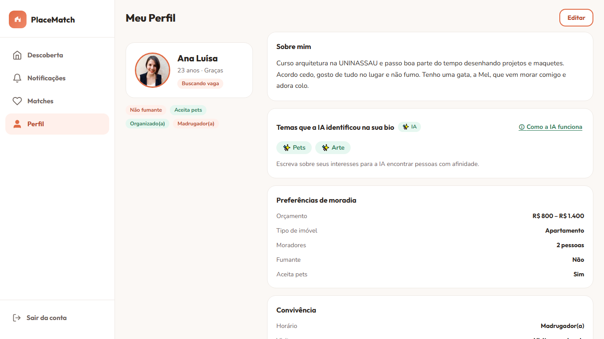 | 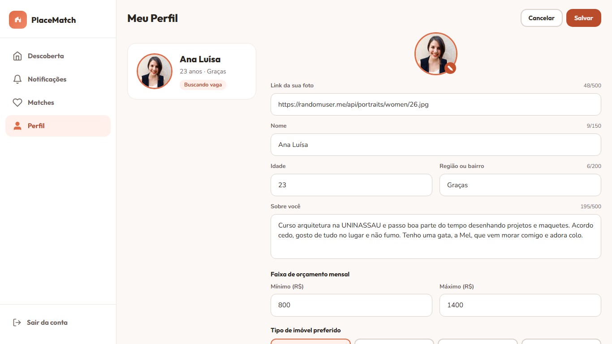 |
|---|---|

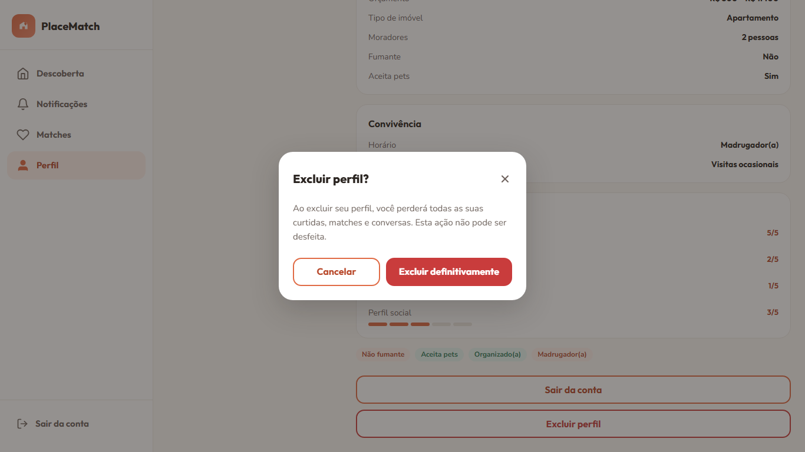

## 13. Denunciar um usuário

Se alguém agir de forma inadequada ou o perfil parecer falso:

1. No detalhe de um anúncio, clique em **Denunciar este anúncio** (no detalhe de uma pessoa, **Denunciar este perfil**); no chat, use o menu **⋮** → **Denunciar**.
2. Escolha o **Motivo**: Spam, Conteúdo ofensivo, Perfil falso ou Outro.
3. Se quiser, escreva uma **Descrição** (até 500 caracteres).
4. Clique em **Enviar denúncia**.

A equipe de administração analisa cada denúncia. Enquanto houver uma denúncia sua pendente contra a mesma pessoa, não é possível enviar outra.

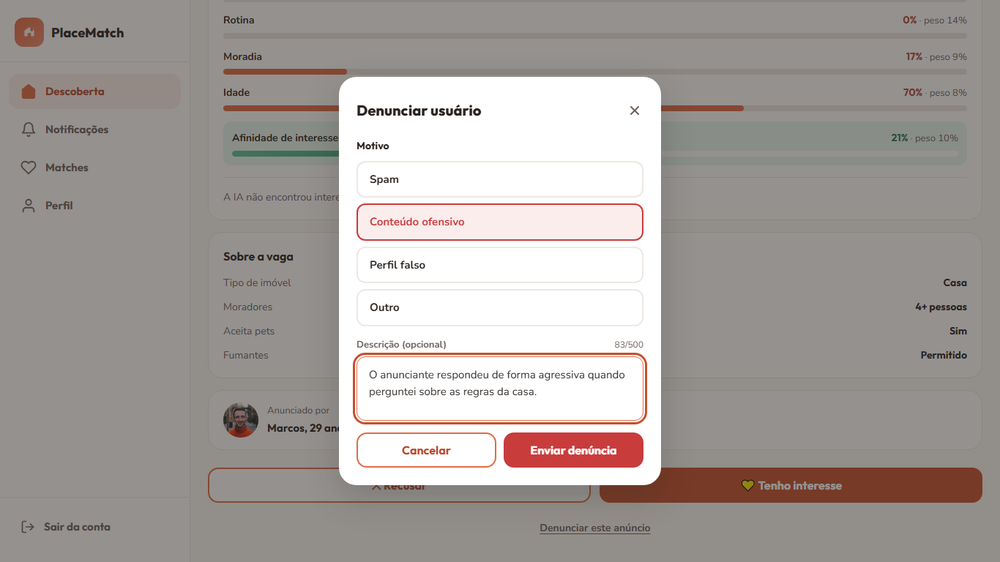

## 14. Painel administrativo

O administrador entra pelo mesmo login e cai direto no **Painel Admin**, com seis abas. As contas de administrador são criadas pela equipe técnica, não pelo cadastro.

### 14.1 Painel

Indicadores do período (Usuários, Perfis, Curtidas, Matches, Taxa de match, Score médio dos matches, Mensagens, Conversas ativas, Contas suspensas e Denúncias pendentes), gráficos de **Atividade diária**, **Top regiões** e **Distribuição de score**. Filtre por período (até 366 dias), região e tipo (Buscando vaga, Oferecendo vaga ou Todos) e clique em **Aplicar**. A **Taxa de match** é a porcentagem das curtidas positivas que viraram match.

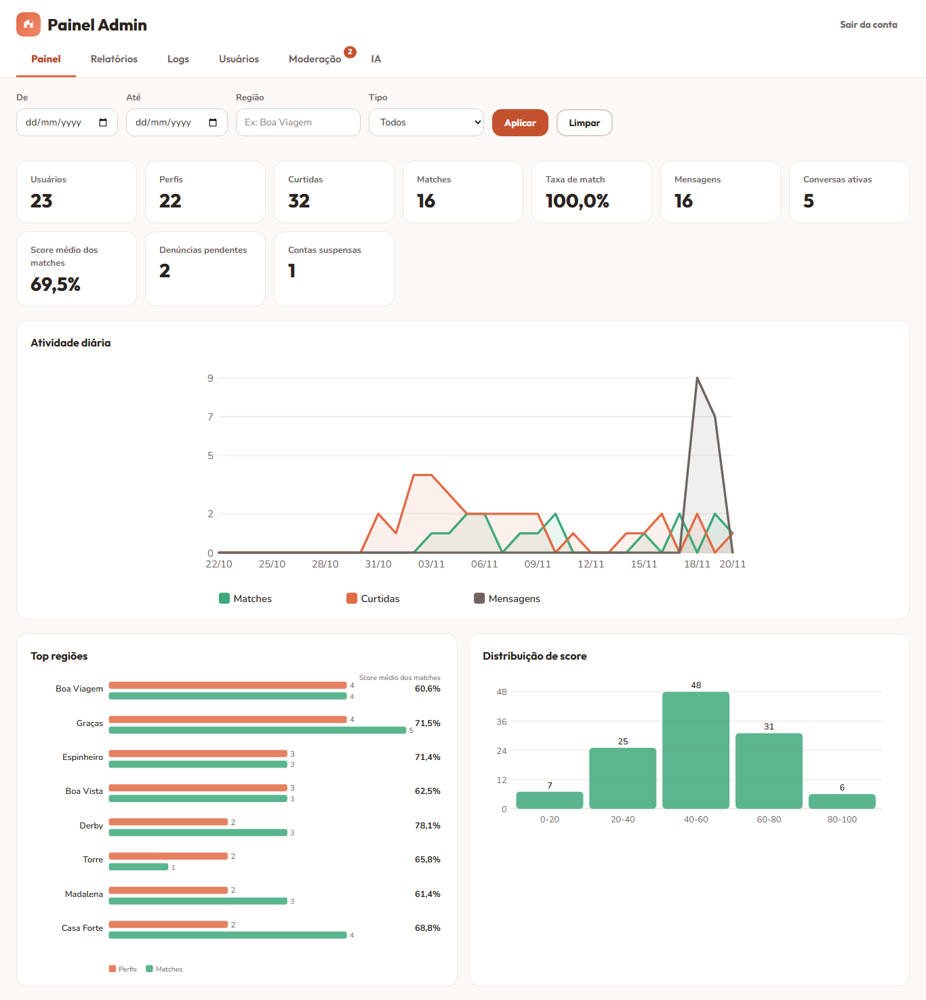

### 14.2 Relatórios

1. Em **Selecionar relatório**, escolha: **Matches**, **Compatibilidade por Região**, **Atividade por Dia**, **Usuários Cadastrados** ou **Denúncias**.
2. Preencha os **Filtros** (Data inicial, Data final, Região, Tipo), conforme o relatório.
3. Clique em **Gerar relatório**. O resultado aparece na tela e pode ser baixado em **Exportar CSV** (abre no Excel, com datas dd/mm/aaaa e vírgula decimal).

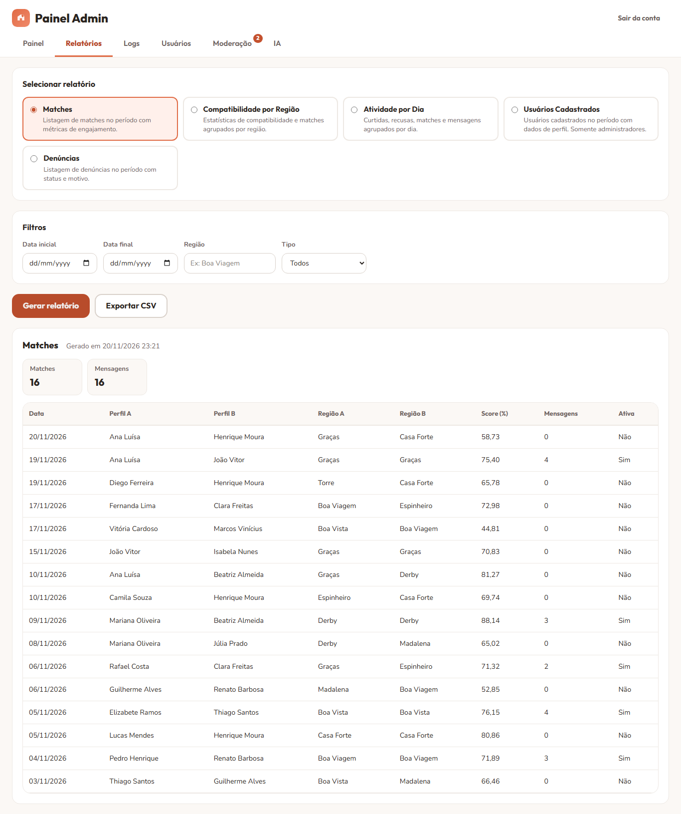

### 14.3 Logs

Histórico das operações do sistema (logins, cadastros, curtidas, matches, mensagens, denúncias, exportações, redefinições de senha e testes da IA no laboratório, em **Teste da IA (painel)**). Filtre por ação, usuário, entidade e período; clique numa linha para ver os detalhes. Os logs nunca mostram senhas nem o texto das mensagens. Também podem ser exportados em CSV.

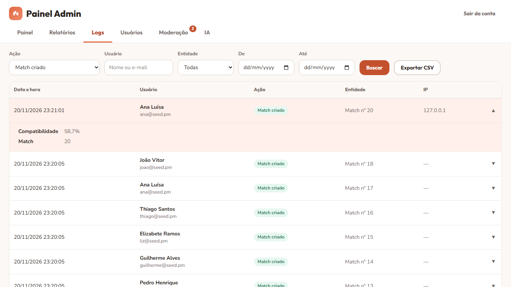

### 14.4 Usuários

Lista de contas com busca por nome ou e-mail, filtros e situação (ativa ou suspensa). Ações: **Suspender** (a pessoa não consegue mais entrar e some da Descoberta, dos matches e do chat) e **Reativar**. A lista pode ser exportada em CSV.

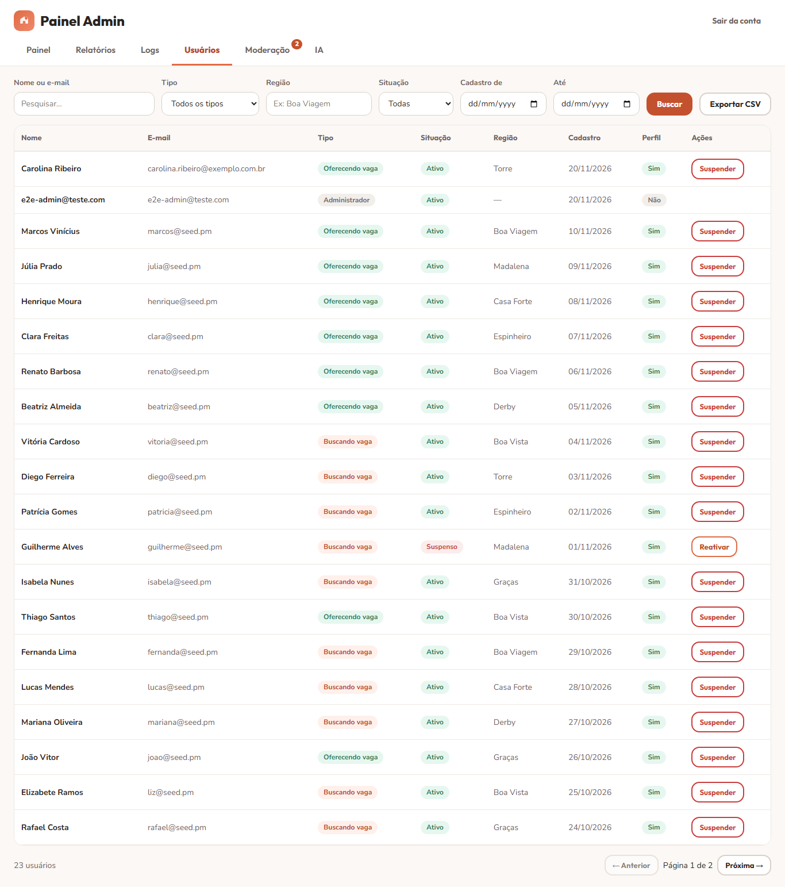

### 14.5 Moderação

O número ao lado da aba indica denúncias pendentes.

1. Filtre por status, motivo, e-mail ou período.
2. Clique em **Analisar** na denúncia.
3. Leia os dados e escolha **Procedente** ou **Improcedente**; escreva uma observação, se quiser.
4. Para denúncia procedente, marque **Suspender a conta do denunciado**, se for o caso.
5. Clique em **Confirmar**.

| 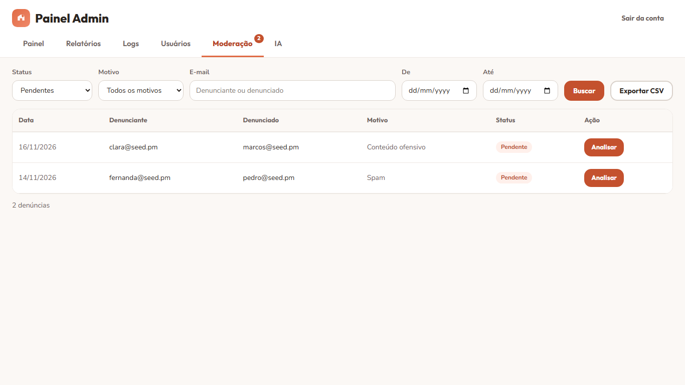 | 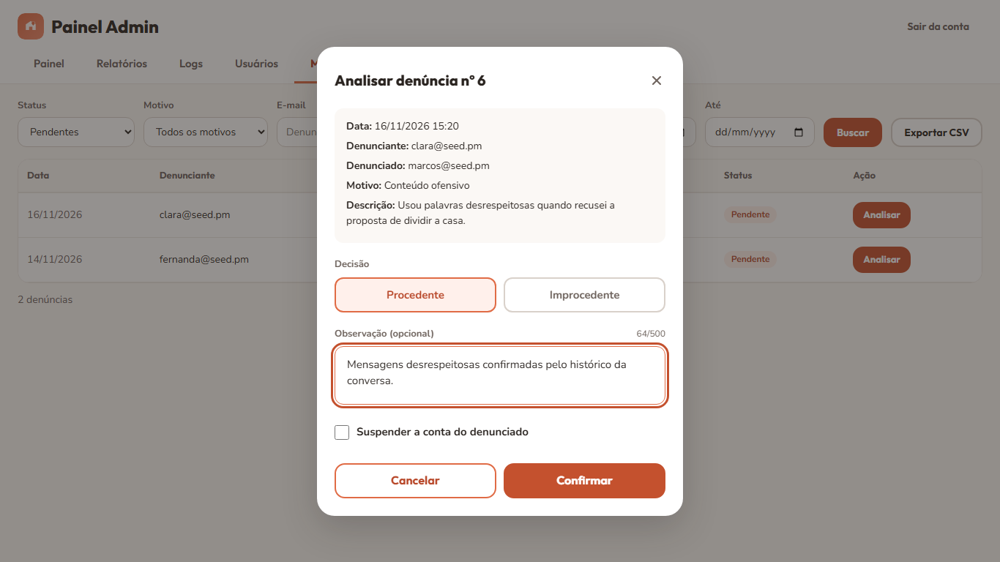 |
|---|---|

### 14.6 IA

A aba **IA** mostra como está a inteligência artificial do sistema e permite testá-la. Ela tem três partes, escolhidas nos botões do topo.

**Status.** Mostra a situação do modelo: **Carregando** (logo depois que o servidor liga; a tela se atualiza sozinha), **Disponível** ou **Indisponível**. Também mostra:

- o nome do modelo e o tamanho do vetor (384 números por bio);
- quantos perfis já foram analisados, do total;
- o tempo médio para analisar uma bio;
- os 16 temas de convivência, com quantas pessoas têm cada um;
- a última atualização.

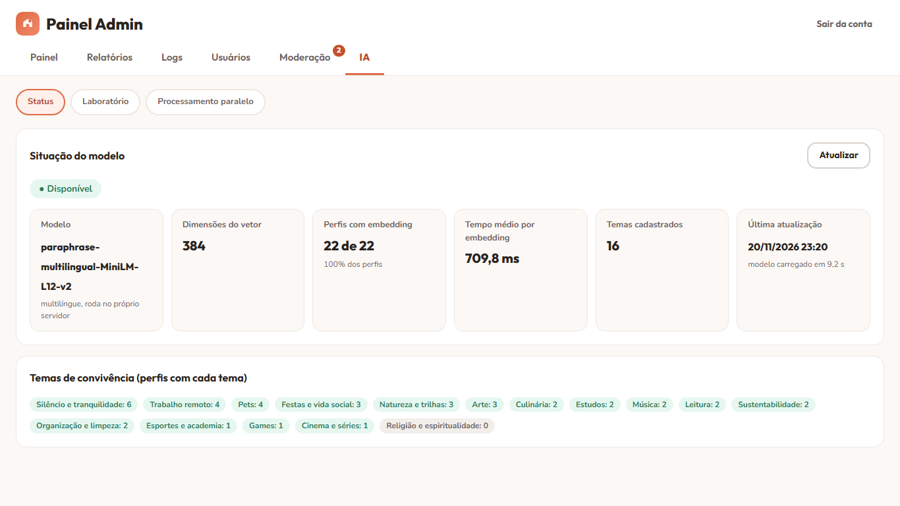

**Laboratório.** Serve para ver a IA funcionando com qualquer texto.

1. Escreva dois textos (até 1000 caracteres cada) ou clique num exemplo pronto: **Interesses parecidos, palavras diferentes**, **Estilos diferentes** ou **Estudo e foco**.
2. Clique em **Comparar com IA**.
3. Leia o resultado:
   - a **similaridade** (o quanto os textos falam das mesmas coisas);
   - a **afinidade** (o valor que entra no score);
   - os temas de cada texto, com os temas em comum destacados com ✨;
   - o tempo que a IA levou.

Os textos testados não são guardados: o log registra só o tamanho e o resultado.

| 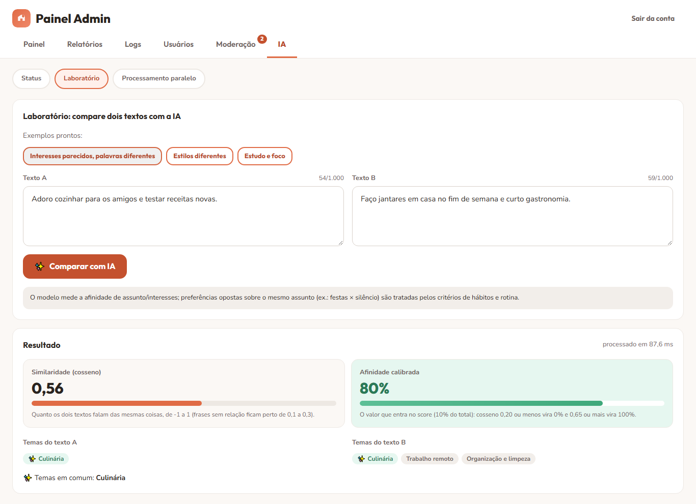 | 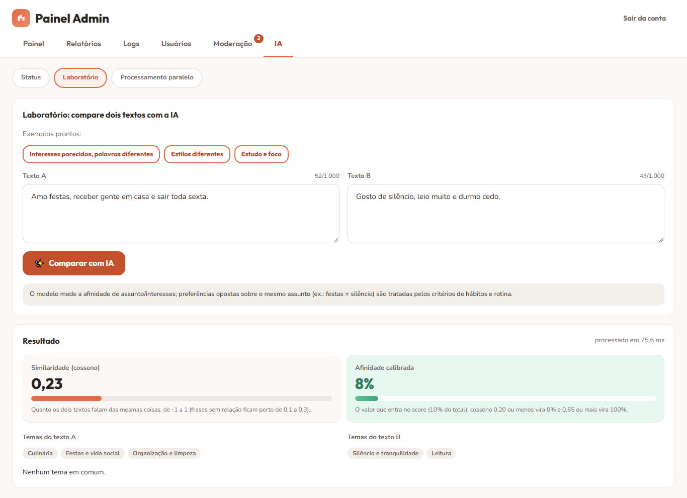 |
|---|---|

No exemplo 2 (festas × silêncio), a afinidade sai baixa porque os assuntos são outros. Quando as preferências são opostas sobre o **mesmo** assunto, quem separa as pessoas são os critérios de hábitos e rotina. A nota fixa abaixo dos campos lembra isso.

**Processamento paralelo.** Mostra o resultado do teste de desempenho que mede o recálculo de todas as compatibilidades usando vários núcleos do processador. Os gráficos mostram, para cada quantidade de perfis (escolha nos botões), o **tempo** e o **speedup** (quantas vezes ficou mais rápido) com 1, 2 e 4 workers, em dois modos: *threads* e *processos*. A tela também mostra:

- a fração do trabalho que pode ser dividida (Lei de Amdahl);
- uma tabela com todos os números;
- o computador usado no teste;
- as conclusões.

Se o teste ainda não foi executado, a tela mostra o comando para a equipe técnica rodar.

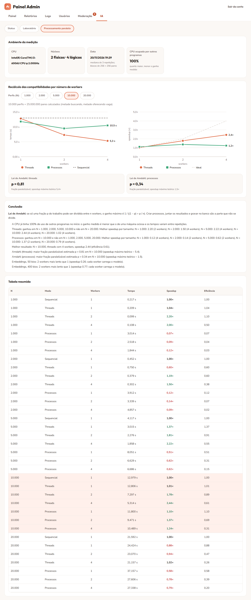

## 15. Uso no celular

O sistema se adapta a telas pequenas: o menu vira uma barra na parte de baixo, os cards ocupam a largura da tela e os botões ficam ao alcance do polegar. Todas as funções do computador estão disponíveis.

| 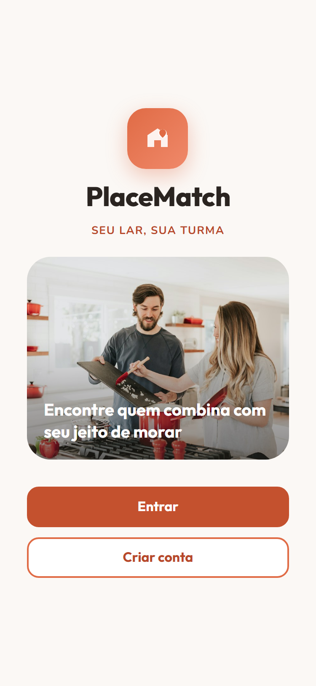 | 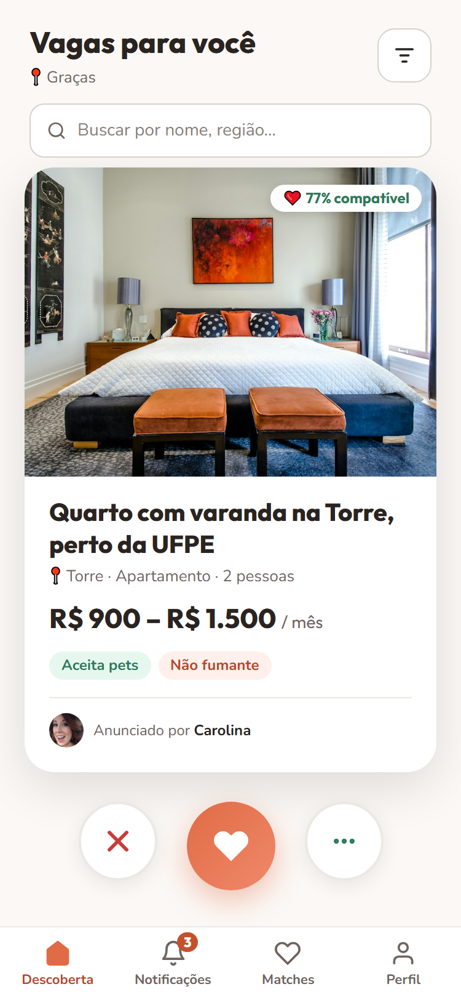 | 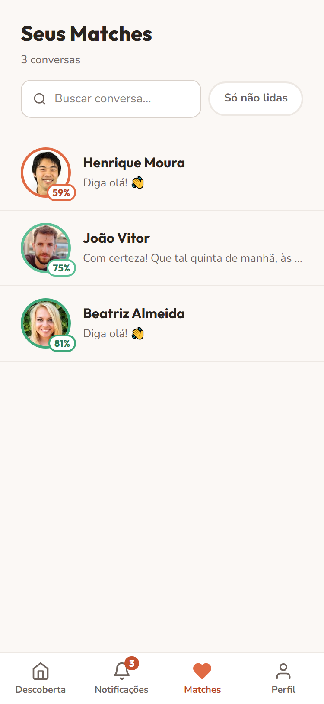 | 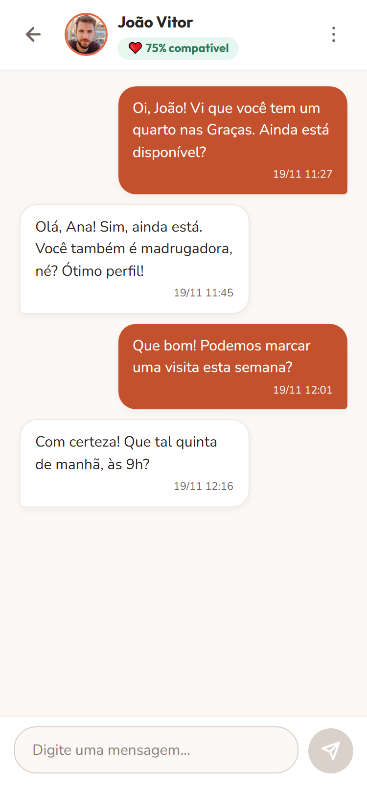 |
|---|---|---|---|

## 16. Mensagens, validações e situações comuns

### 16.1 Mensagens mais frequentes

| Mensagem | Quando aparece | O que fazer |
|---|---|---|
| E-mail ou senha incorretos. | Login com dados errados | Confira os dados ou use **Esqueci minha senha**. |
| Muitas tentativas. Aguarde alguns minutos e tente de novo. | Várias tentativas de login erradas seguidas | Espere alguns minutos. |
| Conta suspensa. Procure o suporte. | Conta suspensa pelo administrador | Entre em contato com a equipe responsável. |
| Este e-mail já está cadastrado. | Cadastro com e-mail que já tem conta | Entre com esse e-mail ou recupere a senha. |
| A senha é muito curta… / Esta senha é muito comum… / A senha não pode ser formada apenas por números. | Cadastro ou nova senha | Escolha uma senha mais forte. |
| Link inválido ou expirado. Peça um novo link. | Link de senha usado ou com mais de 1 hora | Peça um novo link. |
| Sua sessão expirou. Entre novamente. | Sessão encerrada ou vencida | Entre de novo. |
| Idade deve estar entre 18 e 100 anos. | Perfil | Corrija a idade. |
| O máximo deve ser maior ou igual ao mínimo. | Orçamento | Ajuste a faixa. |
| Informe um link http:// ou https:// válido. | Foto do perfil ou do imóvel | Use o endereço completo da imagem. |
| Corrija os campos destacados e tente novamente. | Formulário com erro | Veja os campos em vermelho. |
| Você já avaliou este perfil. | Curtir/recusar de novo | Nenhuma; cada perfil é avaliado uma vez. |
| Você já tem uma denúncia pendente contra este usuário. | Denúncia repetida | Aguarde a análise. |
| Não é possível enviar mensagens: a conta do outro participante está suspensa. | Chat com conta suspensa | Nenhuma. |
| Não foi possível registrar sua curtida. Tente novamente. | Falha de conexão | Verifique a internet e tente de novo; o card continua na lista. |

### 16.2 Situações comuns

- **Não aparece nenhuma opção na Descoberta.** Remova os filtros. Se continuar vazio, ainda não há perfis do tipo oposto cadastrados, ou você já avaliou todos.
- **A foto não aparece.** O link pode estar fora do ar ou não ser de uma imagem. O sistema mostra as iniciais do nome no lugar. Troque o link em **Editar**.
- **Não recebi o e-mail de redefinição.** Confira o endereço digitado e a caixa de spam; peça outro link após alguns minutos (há limite de pedidos).
- **Quero trocar o tipo da conta** (procurar ↔ oferecer). Não é possível pelo sistema: crie outra conta com outro e-mail.
- **A pessoa sumiu dos meus matches.** Ela excluiu o perfil ou a conta foi suspensa.
- **Perdi o que estava digitando no perfil.** O formulário mantém os dados ao voltar entre etapas, mas não guarda se a aba for fechada antes de concluir.

## 17. Afinidade de interesses (IA)

O PlaceMatch usa uma **inteligência artificial** (um modelo de linguagem) que lê o texto **"Sobre você"** das duas pessoas e compara o **significado**, não só as palavras. Por exemplo, "adoro cozinhar para os amigos" e "faço jantares em casa" falam do mesmo interesse, mesmo sem nenhuma palavra igual.

- **Onde roda:** no próprio servidor do PlaceMatch. Nenhum texto é enviado para outras empresas ou serviços.
- **Quanto vale:** 10% do percentual de compatibilidade. Os outros 90% vêm de orçamento, hábitos, região, rotina, moradia e idade.
- **O que ela mede:** interesses em comum, isto é, o assunto das bios. Preferências do dia a dia, como gostar de festas ou de silêncio, horários e organização, ficam com os critérios de hábitos e rotina.
- **Bio curta:** textos com menos de 20 letras não são analisados. O percentual usa os outros 6 critérios, e você não perde pontos por isso. Para quem oferece vaga, o título e a descrição do anúncio também contam.

### 17.1 Selo "Interesses em comum" na Descoberta

Quando a afinidade é alta (70% ou mais) e a IA encontra um tema em comum, o card mostra o selo **"✨ Interesses em comum: Culinária"**, por exemplo. O card mostra só um tema; os demais aparecem no detalhe.

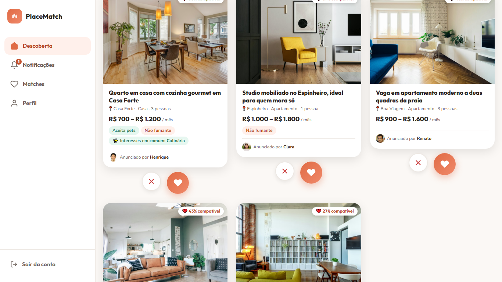

### 17.2 Painel "Por que vocês combinam"

No detalhe de um anúncio ou de uma pessoa, este painel explica o percentual:

- o **percentual total** em destaque;
- uma **barra para cada critério**, com o valor (quanto vocês combinam naquele ponto) e o **peso** (quanto ele vale no total). A afinidade de interesses aparece por último, em verde, com o selo **✨ IA**;
- os **interesses em comum** que a IA encontrou ("A IA identificou interesses em comum: …"). Se não houver nenhum, aparece "A IA não encontrou interesses em comum nas biografias.";
- se uma das bios for curta demais, um aviso explica que o percentual usa os outros 6 critérios, e a barra da IA não aparece.

O link **ⓘ Como a IA funciona** abre um resumo destas explicações.

| 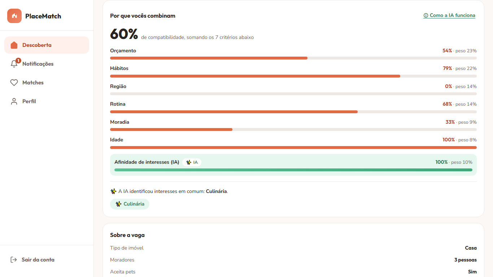 | 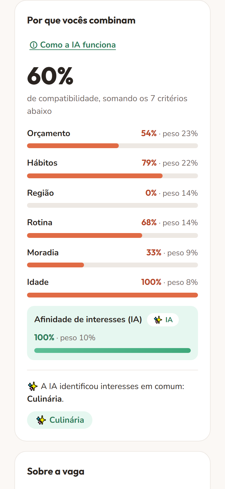 |
|---|---|

### 17.3 Temas da sua bio (Meu Perfil)

Em **Perfil**, o bloco **"Temas que a IA identificou na sua bio"** mostra os temas de convivência encontrados no seu texto (por exemplo: Culinária, Estudos, Pets, Música). Se nenhum aparecer, escreva mais sobre o que você gosta de fazer: **"Escreva sobre seus interesses para a IA encontrar pessoas com afinidade."** Se a bio estiver curta demais, o bloco avisa quantas letras faltam para a análise.

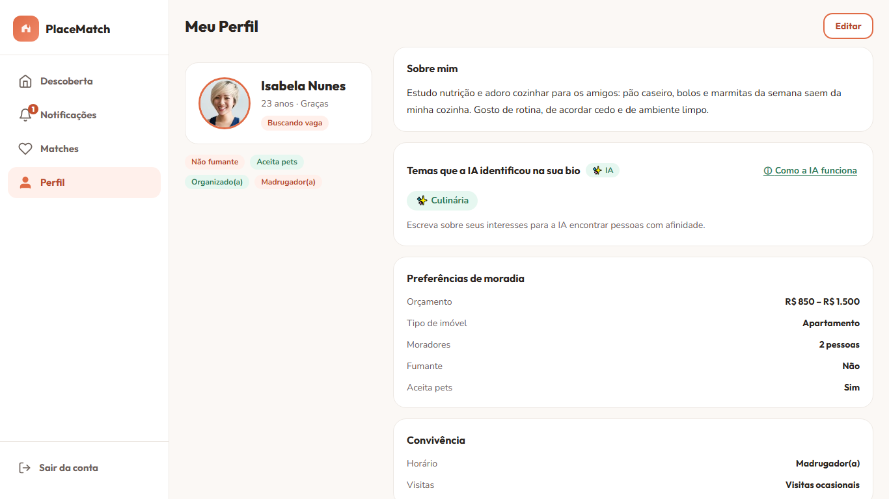
